# Design boards

Rendered reference boards for **tegola**. They come from the CLCTN high-fidelity prototype in `original-spec/` (identical to `mackoj/clctn/design/` at `f6479f9`)
(see `docs/PLAN.md` §0, row 1).

- **Source.** `35_Collections App.dc.html` is the latest prototype. It needs `support.js` and `ios-frame.jsx` next
  to it. The screen comes from the `screen` prop, so each board is one value of that prop. Two reference pages are
  also rendered: `00_Design System.dc.html` (the visual system) and `42_One Roof.dc.html` (the type rules).
- **How the boards were rendered.** Headless Chromium (Playwright) at the prototype's own iPhone frame, 393×852 CSS px
  at 2× (786×1704 PNG). The renderer serves the design folder through request interception. For each board it
  rewrites the `default` of the `screen` prop in `data-props` before load, because `state.screen` is read once in the
  constructor. It also passes `interactive: false`, which stops the item screen's auto-rotation so the frame holds
  still. Props the enum doesn't declare (`tab`, `statsTab`, `scanMode`) are injected the same way to capture states.
  Several screens are implemented but missing from the enum list: `empty`, `quantity`, `match`, `enrich`,
  `edititem`, `review`, `import` and `person`. They were rendered the same way. Where a screen scrolls, the
  continuation frames are `NN-x-p2.png` and `-p3.png`. Each scrolls the screen's own scroll container by one viewport
  minus 160 px, so the status bar overlaps content in those frames. Reference pages are rendered full-page at
  1200 px wide, and One Roof is split into five slices (`34-one-roof-a…e`). PNGs are palette-quantised (256 colours).
  The largest is 132 KB, and the total is about 4 MB. The render script lives outside the repo.
- **Fonts.** Google Fonts were **not** fetched during rendering. unpkg (React, ReactDOM, Babel) is blocked by the
  sandbox proxy, so the renderer serves every external asset locally. The fonts are the woff2 files embedded in the
  self-contained bundle `09_CLCTN App.html`: 22 `@font-face` rules covering Bricolage Grotesque 600/800, Archivo
  400–700 and DM Mono 400/500. So the boards show the **real faces, not fallbacks**: Bricolage Grotesque for display,
  Archivo for UI and body, DM Mono for meta. The status bar's "9:41" belongs to the iOS frame scaffold and uses a
  system fallback. It isn't app typography.
- **Authority.** The prototype is the visual source of truth, and its **copy is final**. It is older than the
  product decision log, though. **The boards set how things look; the PD log sets what is there**
  (`docs/PLAN.md` §4). Each board that disagrees with a decision has a **Differs from the decision log** note.
- **Units.** Every px value below is a CSS px in the 393 pt-wide frame, so read it as pt on iOS. Values come from the
  source's inline styles unless marked *(seen)*.

**Shorthand used below.** Colours are named by token: `ink` #17130F, `paper` #F3ECE0, `sand` #EDE4D6, `card` #FFFFFF,
`muted` #6E6458, `meta` #8A7F70, `rule` #C9BFB0, `ruleDark` #B9AC99, `yellow` #FFD24A, `orange` #FF5B2E,
`pink` #E5457B, `green` #0E6E5E, `cobalt` #2B44D6, `rust` #C2371F, `teal` #12A594, `camera` #0C0A08. See the Token
table. *Mono eyebrow* means `500 9–10px 'DM Mono'`, letter-spacing .12–.14em, uppercase, `meta`. *Card* means
`2.5px solid ink`, radius 14–18, white, `3px 3px 0 ink` or `4px 4px 0 ink` shadow. *Display title* means
Bricolage Grotesque 800, 30–36px, line-height .95–.98, −.03em.

---

## Decision-log differences that apply across many boards

| Decision | What the boards show | What v1 builds |
|---|---|---|
| PD-117 tab bar | `SHELF · LENT · + · STATS · ME` | **Shelf · Find · Scan · Activity · You**. Shelf and Scan are fixed, and the middle slot presents. Keep the board's geometry. |
| PD-080, PD-138 money | Value banners, € figures, "Sell it", the Market tab, the Value stats tab | Money is **off by default** and there are no values in v1. Every € line, value banner, Market tab and Sell button is hidden. The prototype's `selling: false` mode (`sellingOff` blocks) is the layout to follow. |
| PD-145 no 3D | 3D sleeve, disc picker, LiDAR chip, sparkle burst, "+ 3D scan" | Not built. The hero is the collector's **photo**, or the type's **flat hero** (mark + gradient + halftone). |
| PD-013 object screen | Four tabs: Overview / Details / History / Market | **Seven fixed slots**: hero → spine → status → signature → fields → actions → history (see board 34). |
| PD-123 loan note | "WHY (YOU'LL THANK YOURSELF)" as a prominent field | The loan has an **optional note**, not a required why. |
| PD-118 scan | Modes Barcode / Look it up / Photo, with lookup credits in the handoff README | Modes are **photo, barcode and type it**. **Identify is off by default.** There's **no credits meter**. |
| PD-135, PD-122, PD-144 | Sell screens, Market, Pro mode, `tabpick` profiles | **Out of v1.** |
| PD-166 onboarding | `empty` → "Create a collection" → type picker | Onboarding is **"Show us something you love"**, the first piece. It opens the camera with **Type it**, **Library** and **Just look around first** (PLAN F2). The archive's `46_Onboarding - First Piece` page is missing, so no board exists for it. |

---

## 01 · home: My Collections

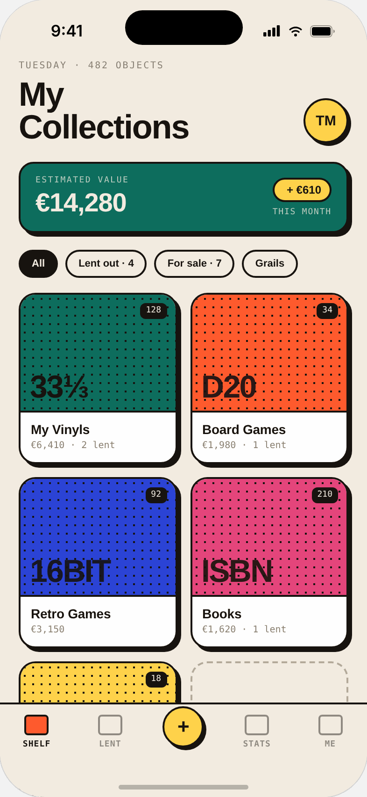 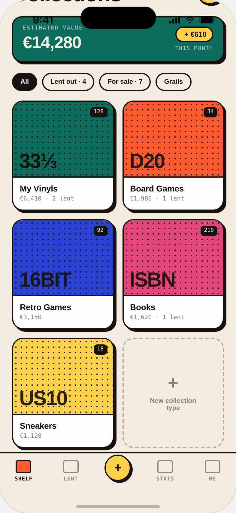

- **Purpose.** The landing screen and Shelf tab root. It shows a count, an overall value and the collections.
- **Layout, top to bottom.** Scroll padding `66px 0 108px`. A header row in 20px gutters: a mono eyebrow
  "TUESDAY · 482 OBJECTS", a display title "My Collections" (36/.96), and on the right a 44×44 avatar "TM" (yellow,
  2.5px ink, `3px 3px 0 ink`, Archivo 700 15, opens Settings). Next, a value banner card (green, radius 16, padding
  14/16, `4px 4px 0 ink`) with the eyebrow "Estimated value" at .75 opacity, "€14,280" (Bricolage 800 28/1.1 −.02em),
  and a yellow pill "+ €610" (Archivo 600 12, 2px ink border) over "THIS MONTH". After that come filter pills: "All"
  (ink fill, paper text), "Lent out · 4", "For sale · 7" and "Grails". Then a 2-up grid of collection tiles: the top
  is a tint block with a dot texture, a count badge (ink, radius 6, DM Mono 9) and a type mark (Bricolage 800 34/.85
  −.04em, opacity .9); the foot sits under a 2.5px top rule and holds the name (Archivo 700 14/1.15) and a mono meta
  line ("€6,410 · 2 lent"). Tiles shown: My Vinyls 33⅓ (green), Board Games D20 (orange), Retro Games 16BIT (cobalt),
  Books ISBN (pink), Sneakers US10 (yellow). The last tile is a dashed `ruleDark` "+ / New collection type" (radius
  18, min-height 150, hover turns orange). The tab bar is at the bottom.
- **Tokens.** paper background; ink; green banner; yellow accents; dot texture
  `radial-gradient(#17130F 1.1px, transparent 1.2px)` at 7–9px.
- **Components.** Header with avatar, ValueBanner, FilterPills, CollectionTile, NewTile (dashed), TabBar.
- **Interactions.** The avatar goes to `settings`, a tile to `collection`, and the dashed tile to `newtype`. The tab
  bar goes to `home`, `lending`, `scan` and `stats`. With `selling: false` the banner turns cobalt and reads
  "Catalogued / 482 objects". Pressed tiles use `transform: translate(1px,1px)`, which collapses the shadow.
- **Differs from the decision log.** The tab labels follow PD-117. The value banner is hidden (PD-138). Use the
  `sellingOff` "Catalogued" variant, or PLAN F3's header count with a Today strip. PLAN F3 lists collections as
  rows with the same row shape for every type, where this board uses a 2-up tile grid.

## 02 · empty: Nothing on the shelf yet

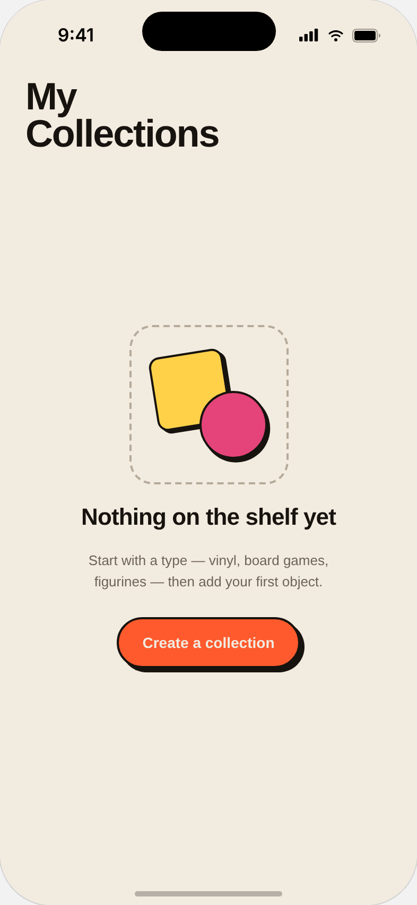

- **Purpose.** The first-run empty shelf.
- **Layout.** Padding `74px 24px 0`. The display title "My Collections" (36/.96). An illustration is centred: a
  150×150 dashed `ruleDark` frame (radius 22) holding a yellow rounded square rotated −9° and a pink circle rotated
  7°, both 2.5px ink with a `3px 3px 0 ink` shadow. Then the heading "Nothing on the shelf yet" (Bricolage 800 22
  −.02em), the body "Start with a type — vinyl, board games, figurines — then add your first object." (Archivo 400
  13/1.5, `muted`, max 250), and the CTA **"Create a collection"** (orange pill, paper text, `4px 4px 0 ink`).
- **Components.** EmptyState illustration, PrimaryButton (orange).
- **Interactions.** The CTA goes to `newtype`.
- **Differs from the decision log.** PD-166 and PLAN F2 replace this. The empty shelf offers **Scan your first
  object** and **Bring your list**, and first launch is the "Show us something you love" camera, not a type picker.
  Keep this board's illustration and type scale.

## 03 · collection: one collection

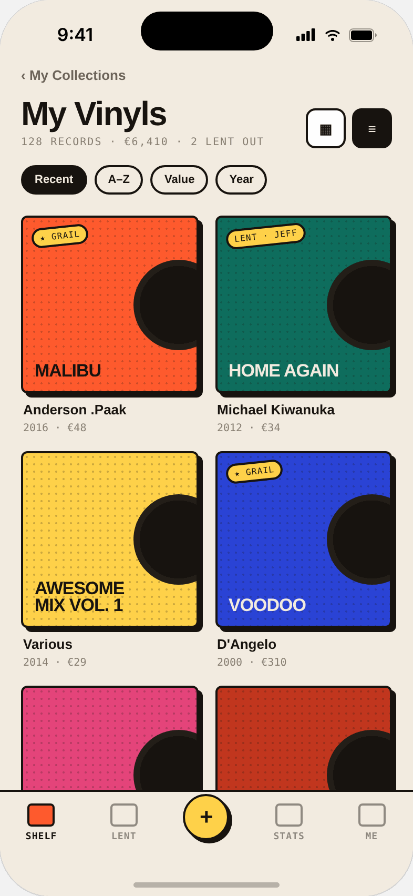 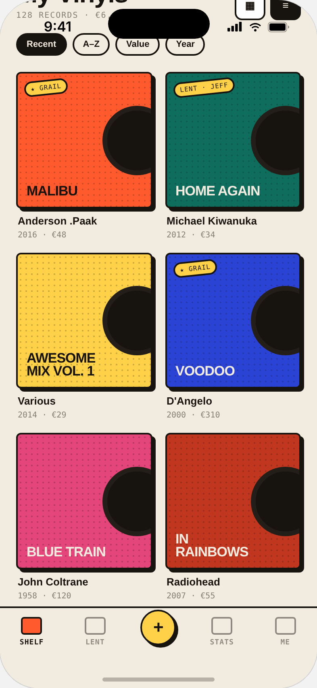

- **Purpose.** The objects in one collection.
- **Layout.** A back row "‹ My Collections" (Archivo 600 13, `muted`). A display title "My Vinyls" with the mono meta
  "128 RECORDS · €6,410 · 2 LENT OUT". On the right, two 44px square view toggles, grid ▦ (white) and list ≡ (ink),
  2.5px ink, radius ~10 *(seen)*. Sort pills: "Recent" (active, ink) / "A–Z" / "Value" / "Year". A 2-up grid of
  sleeves: square tint (aspect 1, 2.5px ink, **radius 6**, `4px 4px 0 ink`) with a dot texture
  `rgba(23,19,15,.22)` 1px at 7px, an ink disc peeking from the right (74px, `6px solid #241F19`), the title
  bottom-left (Bricolage 800 17/.94), and an optional tilted sticker top-left ("★ GRAIL", "LENT · JEFF": yellow,
  DM Mono 8, 2px ink, rotated −6°). Under each sleeve: the artist (Archivo 700 13) and the mono "2016 · €48". Items
  shown: Malibu, Home Again, Awesome Mix Vol. 1, Voodoo, Blue Train, In Rainbows. Tab bar at the bottom.
- **Components.** BackLink, ScreenHeader (title + mono meta), IconToggle, SortPills, SleeveTile (an ObjectTile
  variant), Sticker, TabBar.
- **Interactions.** A tile goes to `item`. The tab bar is as on home.
- **Differs from the decision log.** The tab bar follows PD-117. € figures are hidden (PD-138), so the meta line
  becomes `128 RECORDS · 2 LENT`. PLAN F4 lists objects as **rows** (photo or flat type tile), with grid as this
  board's alternative look.

## 04 · item: object detail (Overview)

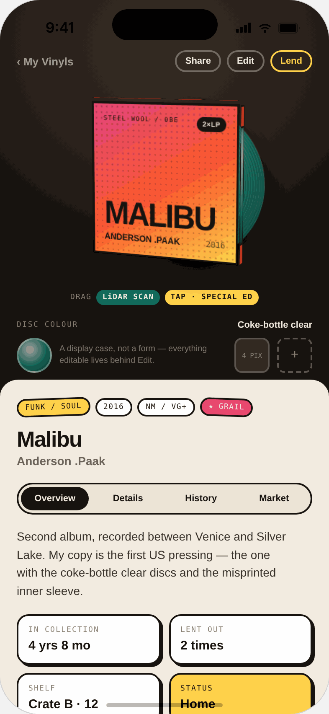 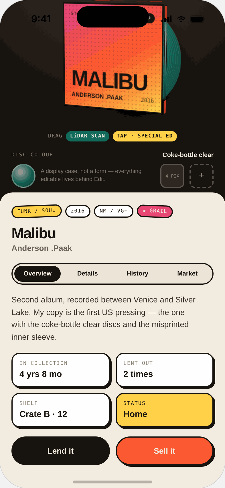
Tab states: 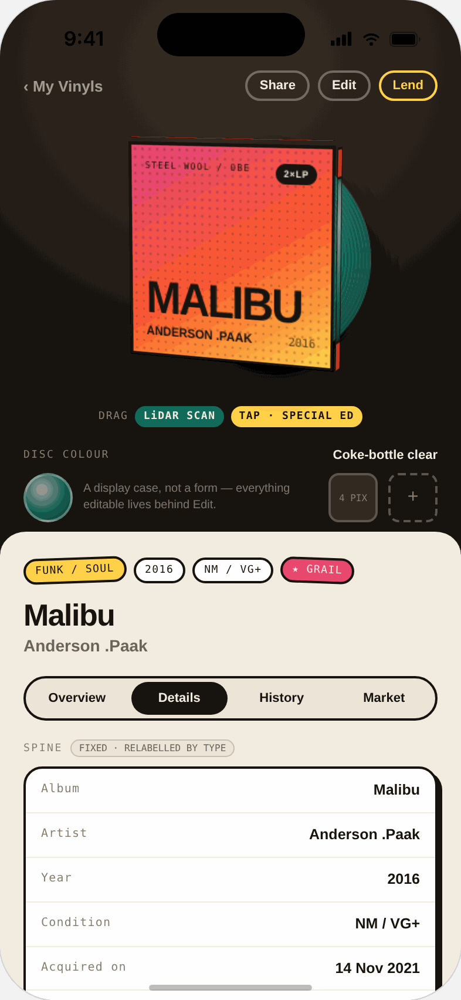 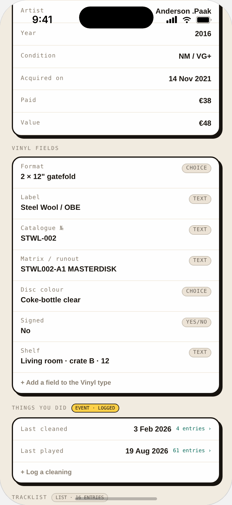
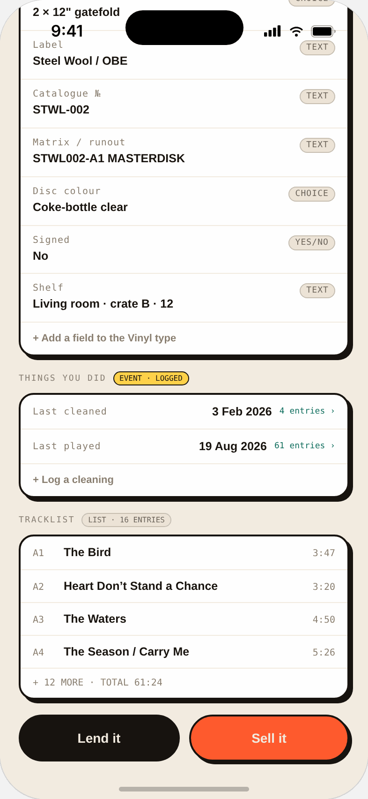 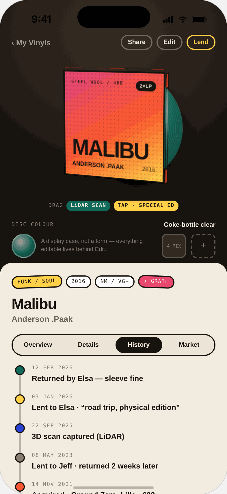
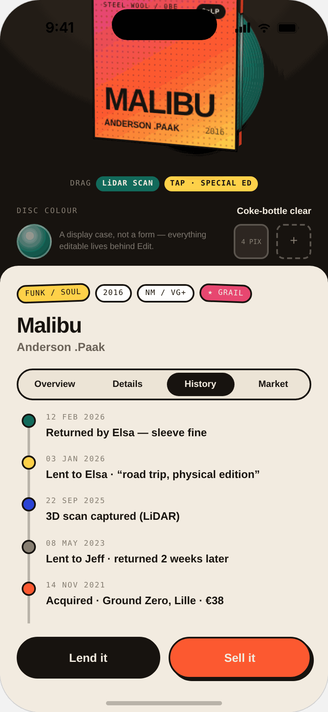 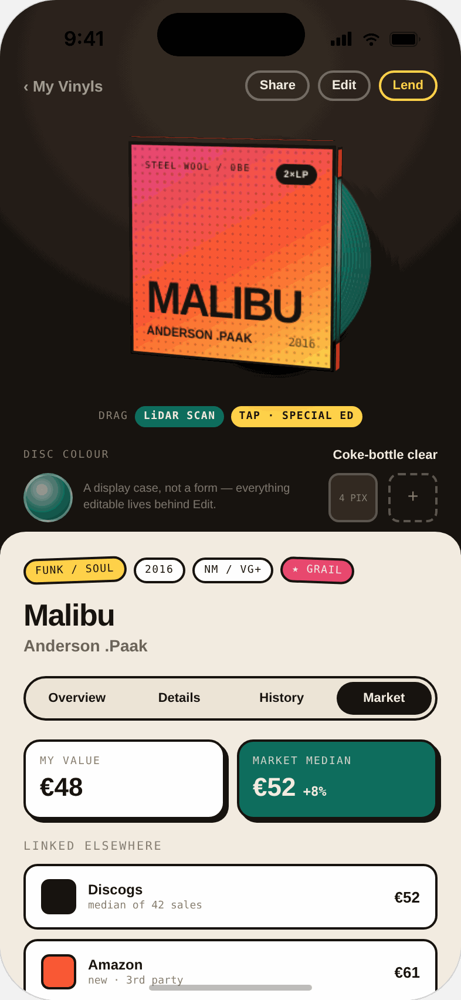 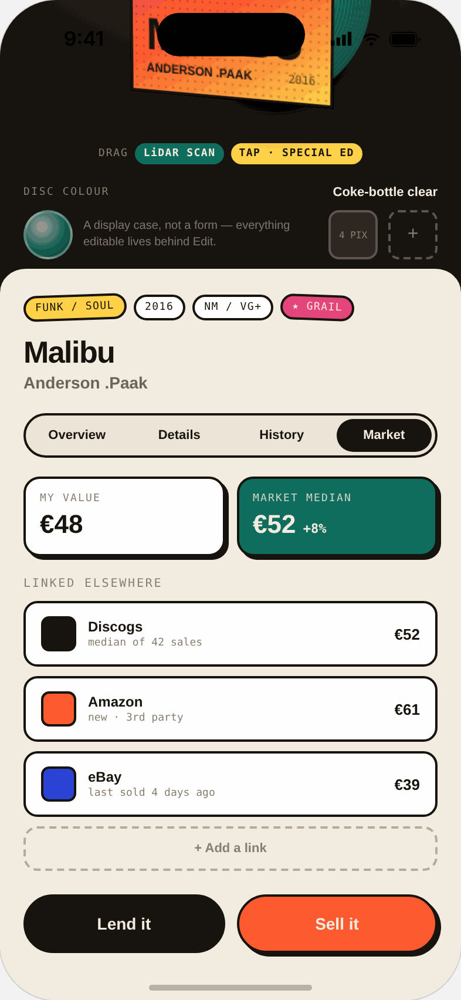

- **Purpose.** The centrepiece: one object as a display case.
- **Layout.** A dark stage with a radial ink gradient. The top row has "‹ My Vinyls" and outline pills on the right:
  "Share", "Edit" (2px `rgba(243,236,224,.35)`) and "Lend" (2px yellow, yellow text). The 3D stage is 260px tall,
  `perspective:1100px`, holding a 186×186 sleeve box (6 faces at `translateZ(5px)`). The back face is #241F19 with
  "TRACKLIST A1–A6", and the disc (182px) sits at `translateZ(-1px)` with groove texture and a paper label ".PAAK".
  The hint row reads "DRAG" plus chips "LiDAR SCAN" (green) and "TAP · SPECIAL ED" (yellow). Then "DISC COLOUR" with
  the selected name "Coke-bottle clear", a disc swatch, the note "A display case, not a form — everything editable
  lives behind Edit.", a "4 PIX" thumb and a dashed "+". Next a paper panel (radius `22px 22px 0 0`, 2.5px top
  rule, `margin-top:-14px`, padding `22px 20px 40px`). It holds chips "FUNK / SOUL" (yellow, −2°), "2016",
  "NM / VG+" and "★ GRAIL" (pink, +2°), all DM Mono 9 with a 2px ink border; the title "Malibu" (Bricolage 800 26);
  the subtitle "Anderson .Paak" (Archivo 600 14, `muted`); a segmented control Overview / Details / History /
  Market (sand track, 2.5px ink, padding 3, active ink pill); the body copy; a 2×2 fact grid "IN COLLECTION 4 yrs
  8 mo", "LENT OUT 2 times", "SHELF Crate B · 12" and "STATUS Home" (yellow); and the buttons **"Lend it"** (ink) and
  **"Sell it"** (orange, `3px 3px 0 ink`), each 15px padding, Archivo 700 14.
  - *Details* (board 35): "SPINE" with the badge "FIXED · RELABELLED BY TYPE", then key/value rows Album, Artist,
    Year, Condition, Acquired on, Paid, Value. "VINYL FIELDS" with kind badges (CHOICE/TEXT/YES/NO): Format, Label,
    Catalogue №, Matrix / runout, Disc colour, Signed, Shelf, then "+ Add a field to the Vinyl type". "THINGS YOU
    DID" with the yellow badge "EVENT · LOGGED": Last cleaned "3 Feb 2026 · 4 entries ›", Last played
    "19 Aug 2026 · 61 entries ›", "+ Log a cleaning". "TRACKLIST" with "LIST · 16 ENTRIES": A1 The Bird 3:47 …,
    "+ 12 MORE · TOTAL 61:24".
  - *History* (board 36): a vertical timeline, a 2px `rule` line with 2.5px-ringed dots coloured per event. Entries:
    12 FEB 2026 Returned by Elsa — sleeve fine; 03 JAN 2026 Lent to Elsa · "road trip, physical edition"; 22 SEP 2025
    3D scan captured (LiDAR); 08 MAY 2023 Lent to Jeff · returned 2 weeks later; 14 NOV 2021 Acquired · Ground Zero,
    Lille · €38.
  - *Market* (board 37): "MY VALUE €48" (white card) next to "MARKET MEDIAN €52 +8%" (green card). "LINKED
    ELSEWHERE" lists Discogs "median of 42 sales" €52, Amazon "new · 3rd party" €61 and eBay "last sold 4 days ago"
    €39, then a dashed "+ Add a link".
- **Components.** DarkNavBar (outline pills), Hero, ChipRow (tilted stickers), SegmentedControl, FactTile,
  KeyValueList, KindBadge, Timeline, ButtonPair.
- **Interactions** (from the logic class).
  - **Idle rotation:** in a rAF loop, `rotY` steps by `dir × 0.18°` per frame and reverses at **±34°**. It starts at
    `rotY −22°, rotX −8°` and pauses while dragging.
  - **Drag:** `onPointerDown` captures the pointer. Then `rotY += dx × 0.6`, clamped ±80°, and
    `rotX −= dy × 0.4`, clamped ±60°. Release ends on pointerup or pointerleave.
  - **Tap** on the sleeve when `specialEdition` is set: a 16-particle sparkle burst at radius 130 + (i%4)·28,
    particle sizes 22/15px, colours yellow/paper/yellow/#FF8A4C, stagger `(i%5)·45ms`. It uses `sparkPop 900ms
    ease-out` (scale .2→1, rotate 120°, fade) plus `sparkGlow 900ms`, and state clears after **950ms**.
  - **Disc picker:** five discs (Black · standard, Coke-bottle clear, Orange splatter, Marbled pink, Picture disc).
    The selected one gets an ink ring, the others `rgba(243,236,224,.25)`.
  - **Tabs:** `setState({tab})` swaps instantly with no animation.
  - Edit goes to `edititem`, Lend to `lendsheet`, Share to `share`, Sell to `sellA`.
- **Differs from the decision log.** PD-013 replaces the four tabs with **seven fixed slots**, hero → spine → status
  → signature → fields → actions → history. The Details and History tab content maps onto the fields and history
  slots. PD-145 drops the 3D sleeve, idle rotation, drag, sparkle, disc picker and LiDAR chip, so the hero is the
  photo or the flat type hero. PD-135 and PD-138 drop "Sell it", the Market tab and the Paid and Value rows. The only
  controls are actions: Edit, Photo, Lend/Return, Let go, Might let go, plus the type verb (PLAN F4).

## 05 · quantity: multiples

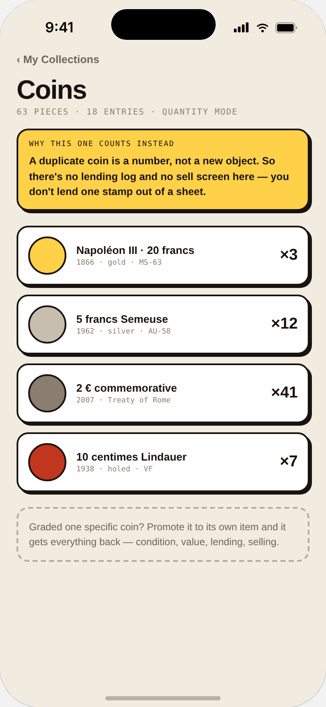

- **Purpose.** A collection in quantity mode. A duplicate is a count, not a row.
- **Layout.** "‹ My Collections", the title "Coins", and the meta "63 PIECES · 18 ENTRIES · QUANTITY MODE". A yellow
  card with the eyebrow "WHY THIS ONE COUNTS INSTEAD" and the bold body "A duplicate coin is a number, not a new
  object. So there's no lending log and no sell screen here — you don't lend one stamp out of a sheet." Four cards,
  each with a coin disc (44px circle, 2.5px ink, metal colour), the name (Archivo 700), mono meta and a big count
  (Bricolage 800): Napoléon III · 20 francs "1866 · gold · MS-63" ×3; 5 francs Semeuse "1962 · silver · AU-58" ×12;
  2 € commemorative "2007 · Treaty of Rome" ×41; 10 centimes Lindauer "1938 · holed · VF" ×7. A dashed `ruleDark`
  note: "Graded one specific coin? Promote it to its own item and it gets everything back — condition, value,
  lending, selling."
- **Components.** CalloutCard (yellow), QuantityRow, DashedNote.
- **Interactions.** Back goes to `home`. A row goes to `promote`.

## 06 · promote: pull one out of the pile (sheet)

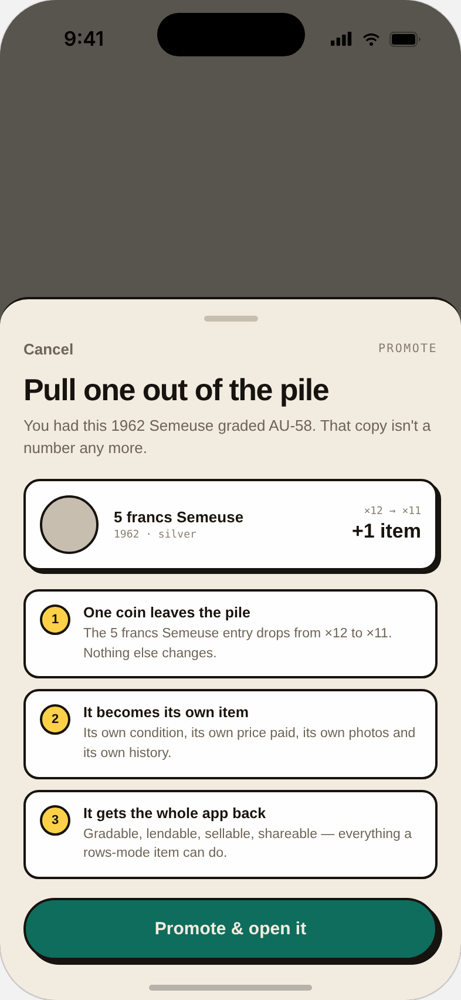

- **Purpose.** A bottom sheet that turns one copy from a ×N entry into its own item.
- **Layout.** Bottom-sheet anatomy (see Components): "Cancel" on the left, the mono "PROMOTE" on the right; the title
  "Pull one out of the pile"; the body "You had this 1962 Semeuse graded AU-58. That copy isn't a number any more.";
  an object card "5 francs Semeuse / 1962 · silver" with "×12 → ×11" and "+1 item"; three numbered step cards with
  yellow numbered circles: "One coin leaves the pile", "It becomes its own item", "It gets the whole app back". The
  CTA **"Promote & open it"** is green with a shadow.
- **Components.** BottomSheet, NumberedStep, PrimaryButton (green).
- **Interactions.** Cancel goes to `quantity`. The CTA goes to `item`.
- **Differs from the decision log.** "sellable" appears in the copy, and selling is out of v1 (PD-135).

## 07 · search

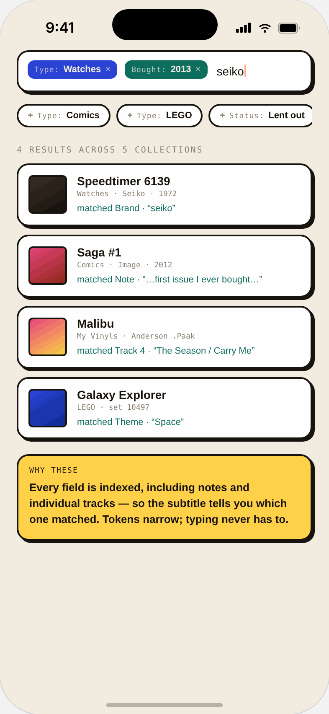

- **Purpose.** Search across every collection, with tokens.
- **Layout.** A bordered field card (white, 2.5px, `4px 4px 0 ink`). It holds a cobalt token "Type: Watches ×" and a
  green token "Bought: 2013 ×" (mono key + Archivo 700 value), then the typed text "seiko" with an orange caret
  (`pulseDot 1.1s infinite`). Suggestion pills: "+ Type: Comics", "+ Type: LEGO", "+ Status: Lent out". The eyebrow
  "4 RESULTS ACROSS 5 COLLECTIONS". Result cards hold a 44px gradient thumb, a title, mono meta and a green "matched
  …" line: Speedtimer 6139 (matched Brand · "seiko"), Saga #1 (matched Note · "…first issue I ever bought…"), Malibu
  (matched Track 4 · "The Season / Carry Me"), Galaxy Explorer (matched Theme · "Space"). A yellow card with the
  eyebrow "WHY THESE": "Every field is indexed, including notes and individual tracks — so the subtitle tells you
  which one matched. Tokens narrow; typing never has to."
- **Components.** SearchField with TokenChip, SuggestionPill, ResultRow (with a match line), CalloutCard.
- **Interactions.** The caret blinks (`pulseDot`, opacity .35↔1).
- **Differs from the decision log.** Search is reached from the **Find** tab (PD-117), not a separate route.

## 08 · settings: Options

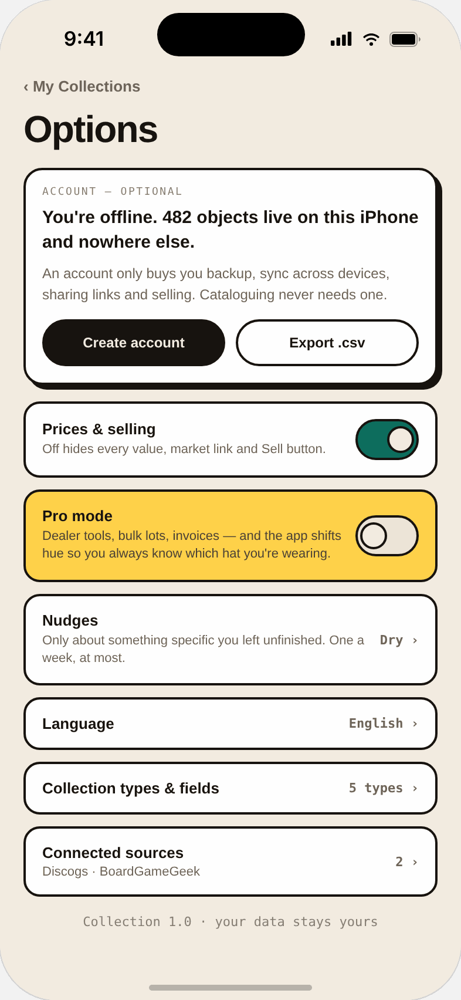

- **Purpose.** Account posture and app options.
- **Layout.** "‹ My Collections" and the title "Options". An account card (`4px 4px 0 ink`) with the eyebrow
  "ACCOUNT — OPTIONAL", "You're offline. 482 objects live on this iPhone and nowhere else." (Archivo 700), the body
  "An account only buys you backup, sync across devices, sharing links and selling. Cataloguing never needs one.",
  and the buttons "Create account" (ink) and "Export .csv" (outline). Toggle rows (radius 14, white, padding
  13/14): "Prices & selling / Off hides every value, market link and Sell button." is ON. "Pro mode / Dealer tools,
  bulk lots, invoices — and the app shifts hue so you always know which hat you're wearing." sits on a yellow row and
  is OFF. Disclosure rows: "Nudges / Only about something specific you left unfinished. One a week, at most." → Dry
  ›; "Language" → English ›; "Collection types & fields" → 5 types ›; "Connected sources / Discogs · BoardGameGeek"
  → 2 ›. The footer is mono: "Collection 1.0 · your data stays yours".
- **Toggle spec.** 46×27, 2.5px ink, radius 999, padding 2. ON is a green track with the knob at the end. The knob is
  19×19, paper, 2px ink. OFF is sand with the knob at the start.
- **Components.** Card, Toggle, SettingsRow (with a mono value and ›), ButtonPair.
- **Interactions.** Back goes to `home`. Nudges goes to `nudge`.
- **Differs from the decision log.** Pro mode is out (PD-144). "Prices & selling" defaults to **off**, and v1 shows
  no values (PD-080, PD-138), so the copy about the Sell button doesn't apply in v1 (PD-135). Settings live under
  **You** (PD-117).

## 09 · scan: camera (Barcode)

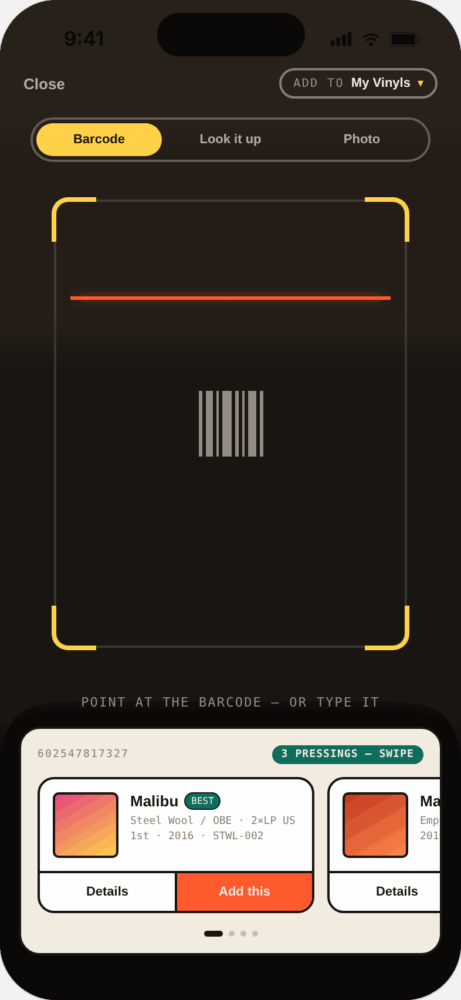 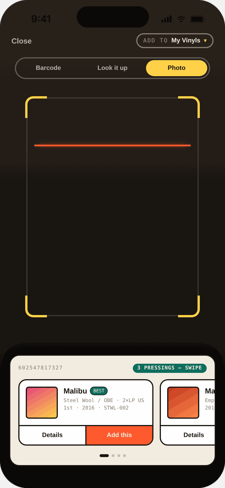 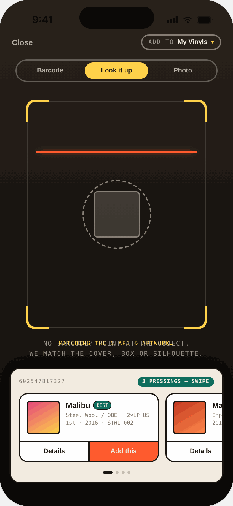

- **Purpose.** The capture viewfinder.
- **Layout.** A dark camera screen, `camera` #0C0A08 with the gradient `linear-gradient(180deg,#2A231C,#0C0A08)`.
  The top row has "Close" on the left and, on the right, a pill "ADD TO My Vinyls ▾" (mono key + Archivo 700 value,
  yellow ▾). A segmented control Barcode / Look it up / Photo: the active pill is yellow with ink text, inactive
  text is `rgba(243,236,224,.7)`, and the track has a 2.5px paper-alpha border. The viewfinder sits at left/right 46,
  top 170, bottom 300, with a 2px `rgba(243,236,224,.15)` frame (radius 14) and four 34×34 yellow corner brackets
  (4px). A scan line (3px orange, `box-shadow 0 0 14px #FF5B2E`) runs `camScan 1.8s ease-in-out infinite alternate`,
  translateY 0→150px. In barcode mode a faint barcode glyph sits in the centre, with the caption "POINT AT THE
  BARCODE — OR TYPE IT". A result tray rises from the bottom: a paper card on an ink sheet holding the raw code
  "602547817327", a green chip "3 PRESSINGS — SWIPE", and horizontally swiping match cards (thumb, "Malibu", green
  "BEST" badge, mono "Steel Wool / OBE · 2×LP US 1st · 2016 · STWL-002", split buttons "Details" and **"Add this"**
  in orange) with page dots.
  - *Look it up* (board 40): a dashed circle and a placeholder square in the centre, the yellow caption "MATCHING
    THE SHAPE & ARTWORK…", and the helper "NO BARCODE? POINT AT THE OBJECT. WE MATCH THE COVER, BOX OR SILHOUETTE."
    The two captions overlap in the prototype. That's a layout bug in the source: one is absolutely positioned at
    `bottom:-32px`. Don't copy it.
  - *Photo* (board 39): an empty viewfinder. In the source, the Photo pill goes to `crate` (continuous capture).
- **Components.** CameraChrome, DestinationPill, SegmentedControl (dark), Viewfinder, ScanLine, MatchCarousel /
  MatchCard.
- **Interactions.** `setScanBarcode` and `setScanLook` switch modes instantly. Photo goes to `crate`. "Details" goes
  to `match`, "Add this" to `addform`, Close to `home`.
- **Differs from the decision log.** PD-118 sets the modes to **photo, barcode and type it**, with "Look it up"
  replaced by "Type it". Identify is off by default, and there's no lookup-credit meter. The "Add to" pill defaults
  to the last-used collection (PLAN F6). After a shot the camera stays open and the object goes to a tray.

## 10 · match: Match confirm

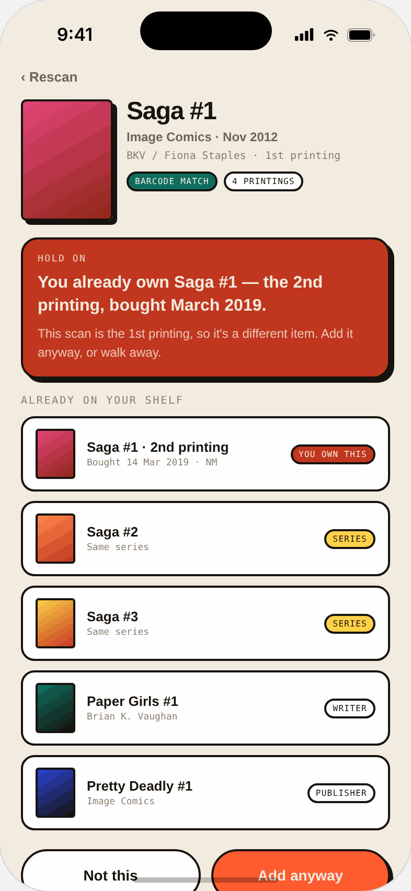 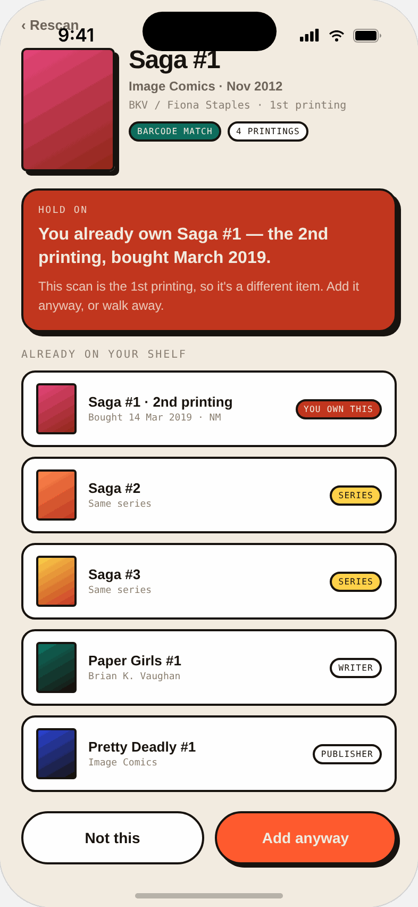

- **Purpose.** A barcode matched, and you might already own it.
- **Layout.** "‹ Rescan". A header with a tall cover (`4px 4px 0 ink`), the title "Saga #1", "Image Comics · Nov
  2012", the mono "BKV / Fiona Staples · 1st printing", and the chips "BARCODE MATCH" (green) and "4 PRINTINGS". A rust
  alert card with the eyebrow "HOLD ON": "You already own Saga #1 — the 2nd printing, bought March 2019." / "This
  scan is the 1st printing, so it's a different item. Add it anyway, or walk away." Then "ALREADY ON YOUR SHELF"
  rows with right-hand chips: Saga #1 · 2nd printing "Bought 14 Mar 2019 · NM" [YOU OWN THIS, rust]; Saga #2 "Same
  series" [SERIES, yellow]; Saga #3 [SERIES]; Paper Girls #1 "Brian K. Vaughan" [WRITER]; Pretty Deadly #1 "Image
  Comics" [PUBLISHER]. The buttons are **"Not this"** (outline) and **"Add anyway"** (orange).
- **Components.** ObjectHeader, AlertCard (rust), RelatedRow with StatusChip, ButtonPair.
- **Interactions.** Rescan goes to `scan`. Add anyway goes to `addform`.

## 11 · enrich: Fill the gaps? (sheet)

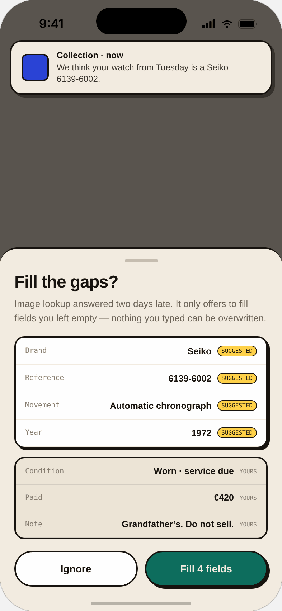

- **Purpose.** A late lookup offers to fill only the fields you left empty.
- **Layout.** A notification banner over a dimmed backdrop: a paper card with a cobalt app square, "Collection ·
  now", and "We think your watch from Tuesday is a Seiko 6139-6002." A bottom sheet with the title "Fill the gaps?"
  and the body "Image lookup answered two days late. It only offers to fill fields you left empty — nothing you
  typed can be overwritten." A white list card shows suggested rows (mono key + Archivo 700 value + yellow
  "SUGGESTED" chip): Brand Seiko, Reference 6139-6002, Movement Automatic chronograph, Year 1972. A sand list card
  shows locked rows tagged "YOURS": Condition "Worn · service due", Paid €420, Note "Grandfather's. Do not sell."
  The buttons are **"Ignore"** and **"Fill 4 fields"** (green).
- **Components.** NotificationBanner, BottomSheet, KeyValueList (suggested and owned variants), StatusChip, ButtonPair.
- **Interactions.** Ignore goes to `home`. Fill goes to `item`.
- **Differs from the decision log.** Image lookup belongs to Identify, which is off by default (PD-118). Hide the
  Paid row when money is off.

## 12 · addform: Add vinyl

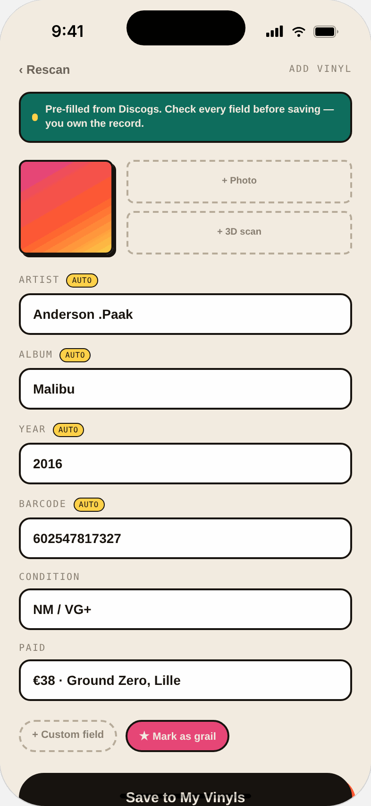 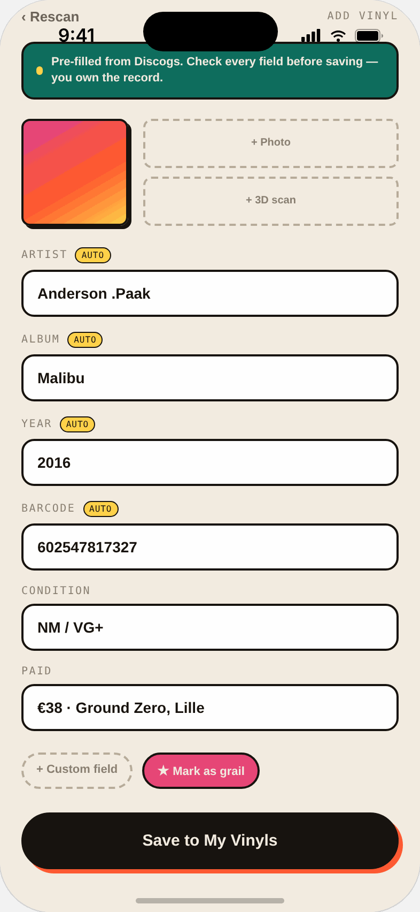

- **Purpose.** A type-specific add form, pre-filled by a lookup.
- **Layout.** "‹ Rescan" and the mono "ADD VINYL". A green banner with a yellow dot: "Pre-filled from Discogs. Check
  every field before saving — you own the record." A media row: the cover, then dashed "+ Photo" and "+ 3D scan".
  Labelled fields (mono label, a yellow **AUTO** badge where filled; inputs 2.5px ink, radius 11, white): ARTIST
  Anderson .Paak; ALBUM Malibu; YEAR 2016; BARCODE 602547817327; CONDITION NM / VG+; PAID €38 · Ground Zero, Lille.
  Then "+ Custom field" (dashed) and "★ Mark as grail" (pink). The CTA is **"Save to My Vinyls"** (ink with an
  orange `4px 4px 0` shadow).
- **Components.** InfoBanner, MediaSlot (dashed), FormField, AutoBadge, DashedButton, PrimaryButton (ink on orange
  shadow).
- **Interactions.** Back goes to `scan`. Save goes to `collection`.
- **Differs from the decision log.** "+ 3D scan" isn't built (PD-145). PAID is hidden when money is off (PD-080).

## 13 · edititem: Edit object

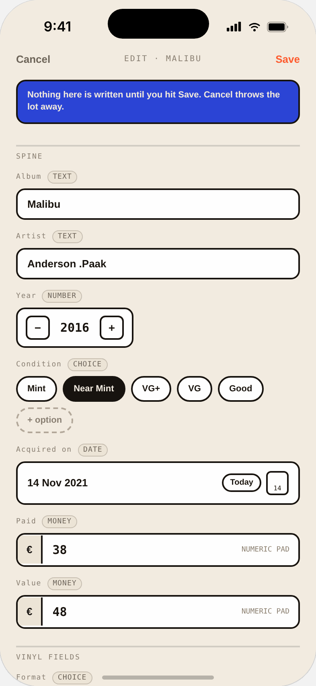 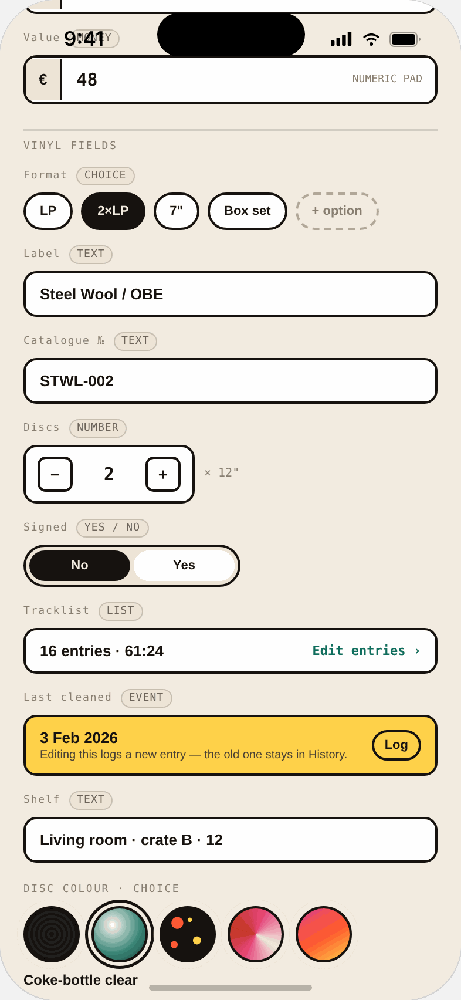 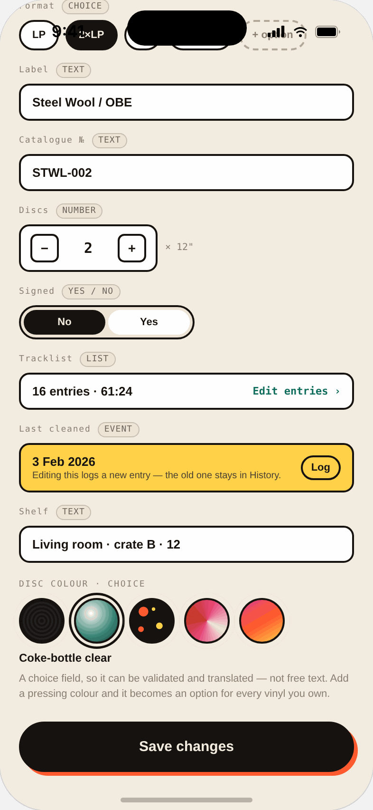

- **Purpose.** Edits every field with the control its kind gets. Nothing is written until Save.
- **Layout.** A modal nav: "Cancel" (`muted`), the mono "EDIT · MALIBU", and "Save" (orange). A cobalt banner:
  "Nothing here is written until you hit Save. Cancel throws the lot away." The "SPINE" section sits under a 2px
  `rule`. Each field is a mono label plus a **kind badge** (sand pill, mono: TEXT, NUMBER, CHOICE, DATE, MONEY,
  YES / NO, LIST, EVENT):
  - Text: input 2.5px ink, radius 11, padding 10/12, Archivo 600 13 (Album Malibu, Artist Anderson .Paak).
  - Number: stepper box (2.5px, radius 11) with 26×26 `−` / `+` squares (2px ink, radius 7), the value in DM Mono
    600 15 and a unit beside it (Year 2016, Discs 2 "× 12"").
  - Choice: chips Archivo 600 11, padding 8/12, 2px ink, radius 999; the selected one is ink-filled; plus a dashed
    "+ option" (Condition Mint / **Near Mint** / VG+ / VG / Good; Format LP / **2×LP** / 7" / Box set).
  - Date: a value with a "Today" pill and a 24×24 calendar glyph showing "14" (Acquired on 14 Nov 2021).
  - Money: a sand "€" prefix cell with a 2.5px right rule, the value in DM Mono 600 15, and a "NUMERIC PAD" hint
    (Paid 38, Value 48).
  - Yes/No: a sand track 2.5px with No / Yes segments, min-width 62 (Signed **No**).
  - List: "16 entries · 61:24" with a green mono "Edit entries ›".
  - Event: a yellow box "3 Feb 2026 / Editing this logs a new entry — the old one stays in History." with a "Log" pill.
  - "VINYL FIELDS" section: Label Steel Wool / OBE, Catalogue № STWL-002, Shelf "Living room · crate B · 12".
  - "DISC COLOUR · CHOICE": five disc swatches with the selected one ringed, the name "Coke-bottle clear", and the
    note "A choice field, so it can be validated and translated — not free text. Add a pressing colour and it
    becomes an option for every vinyl you own."
  - The CTA is **"Save changes"** (ink with an orange shadow).
- **Components.** ModalNavBar (Cancel / title / Save), InfoBanner, SectionRule, FieldLabel + KindBadge, and the
  field controls TextField, Stepper, ChoiceChips, DateField, MoneyField, YesNoSegment, ListField, EventField and
  SwatchPicker.
- **Interactions.** Cancel and Save both go to `item`.
- **Differs from the decision log.** Money fields are hidden when money is off (PD-080). The disc colour is a choice
  value with no 3D rendering (PD-145). PLAN F5 adds a **Place** field and **Add a detail**, and Save appends one
  `edited` event.

## 14 · review: Tidy later (crate review)

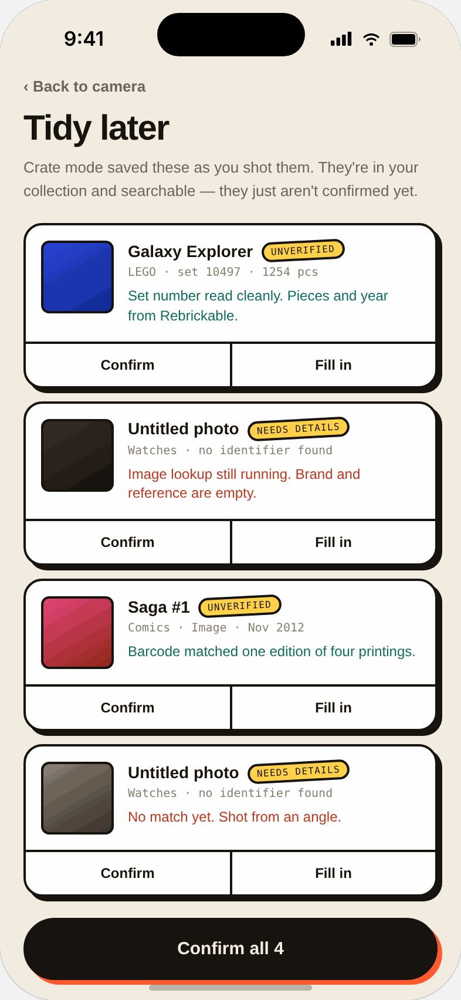 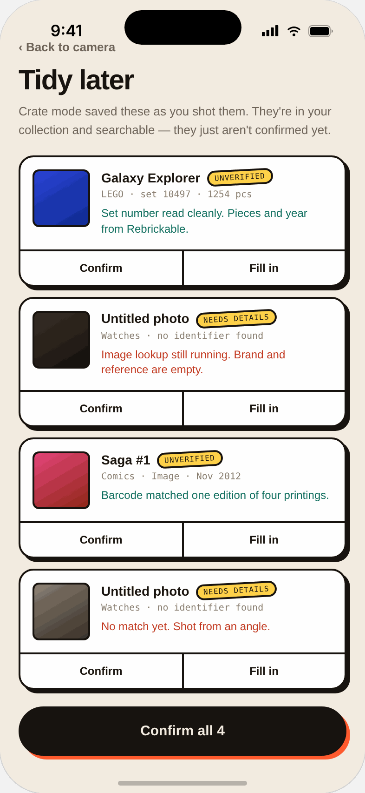

- **Purpose.** The queue that crate mode captured, waiting for confirmation.
- **Layout.** "‹ Back to camera", the title "Tidy later", and the body "Crate mode saved these as you shot them.
  They're in your collection and searchable — they just aren't confirmed yet." Cards with a thumb, title, tilted
  status sticker (−3°), mono meta and a coloured note (green for a good read, rust for a problem), with split
  buttons "Confirm" | "Fill in" under a 2.5px rule: Galaxy Explorer [UNVERIFIED] "LEGO · set 10497 · 1254 pcs /
  Set number read cleanly. Pieces and year from Rebrickable."; Untitled photo [NEEDS DETAILS] "Watches · no
  identifier found / Image lookup still running. Brand and reference are empty."; Saga #1 [UNVERIFIED] "Barcode
  matched one edition of four printings."; Untitled photo [NEEDS DETAILS] "No match yet. Shot from an angle." The CTA
  is **"Confirm all 4"** (ink with an orange shadow).
- **Components.** ReviewCard with Sticker and SplitActions, PrimaryButton.
- **Interactions.** Back goes to `crate`. Fill in goes to `addform`. Confirm all goes to `collection`.
- **Differs from the decision log.** "Image lookup" only runs if Identify is switched on (PD-118).

## 15 · offline: lookup with no network

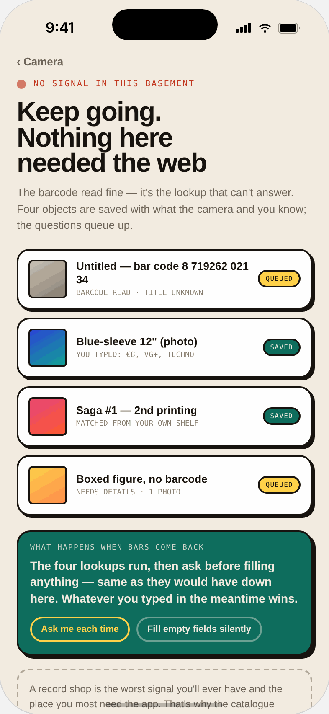 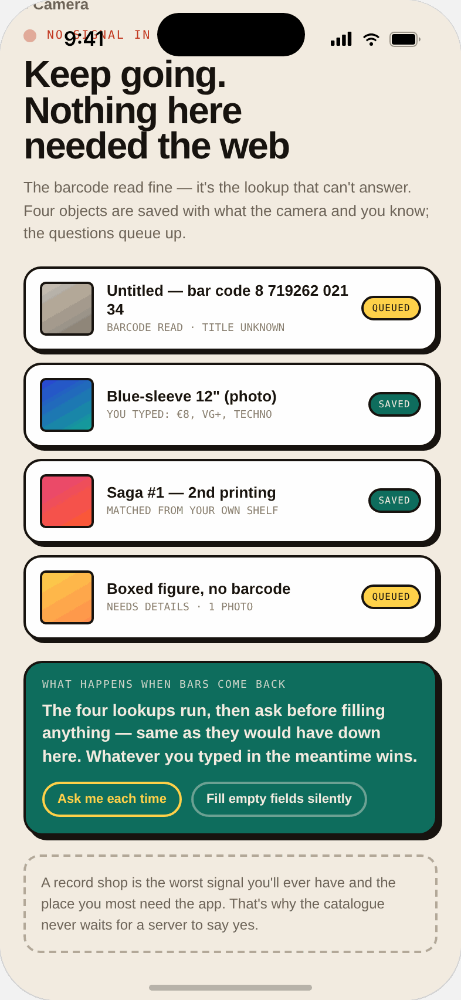

- **Purpose.** Captures saved and queued while there's no signal.
- **Layout.** "‹ Camera". A pulsing rust dot (`pulseDot 1.2s infinite`) beside the rust mono "NO SIGNAL IN THIS
  BASEMENT". The display title "Keep going. Nothing here needed the web", then the body "The barcode read fine
  — it's the lookup that can't answer. Four objects are saved with what the camera and you know; the questions queue
  up." Rows with a status chip: "Untitled — bar code 8 719262 021 34 / BARCODE READ · TITLE UNKNOWN" [QUEUED,
  yellow]; "Blue-sleeve 12" (photo) / YOU TYPED: €8, VG+, TECHNO" [SAVED, green]; "Saga #1 — 2nd printing / MATCHED
  FROM YOUR OWN SHELF" [SAVED]; "Boxed figure, no barcode / NEEDS DETAILS · 1 PHOTO" [QUEUED]. A green card with the
  eyebrow "WHAT HAPPENS WHEN BARS COME BACK": "The four lookups run, then ask before filling anything — same as they
  would have down here. Whatever you typed in the meantime wins." Option pills "Ask me each time" (yellow outline,
  selected) and "Fill empty fields silently". A dashed note: "A record shop is the worst signal you'll ever have and
  the place you most need the app. That's why the catalogue never waits for a server to say yes."
- **Components.** StatusEyebrow with PulseDot, ObjectRow + StatusChip, CalloutCard (green) with OptionPills,
  DashedNote.
- **Interactions.** Back goes to `scan`. The dot pulses (opacity .35↔1, 1.2s).

## 16 · import: first hour

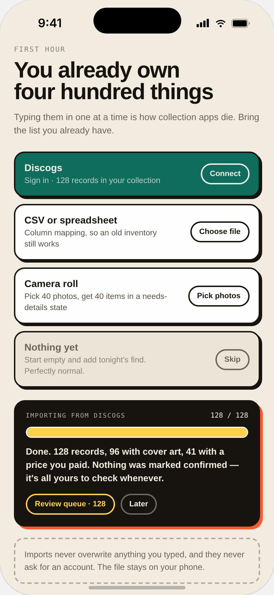 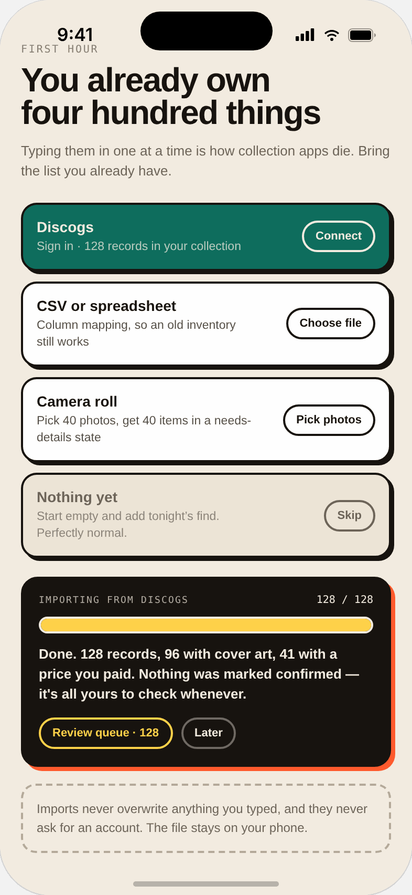

- **Purpose.** Bring an existing list instead of typing everything in.
- **Layout.** The eyebrow "FIRST HOUR", the title "You already own four hundred things", and the body "Typing them
  in one at a time is how collection apps die. Bring the list you already have." Source cards with a right-hand
  pill: **Discogs** "Sign in · 128 records in your collection" [Connect] on a green card with a paper-outline pill;
  **CSV or spreadsheet** "Column mapping, so an old inventory still works" [Choose file]; **Camera roll** "Pick 40
  photos, get 40 items in a needs-details state" [Pick photos]; **Nothing yet** "Start empty and add tonight's find.
  Perfectly normal." [Skip] on a sand, muted card. A progress card (ink, `4px 4px 0 orange`) with "IMPORTING FROM
  DISCOGS 128 / 128" and a full yellow progress bar (paper-bordered track): "Done. 128 records, 96 with cover art, 41
  with a price you paid. Nothing was marked confirmed — it's all yours to check whenever." Pills "Review queue · 128"
  (yellow outline) and "Later". A dashed note: "Imports never overwrite anything you typed, and they never ask for
  an account. The file stays on your phone."
- **Components.** SourceCard, ProgressCard (dark, orange shadow), ProgressBar, DashedNote.
- **Interactions.** Review queue goes to `review`. Skip goes to `home`.
- **Differs from the decision log.** PLAN F2 has "Bring your list" on the empty shelf lead here. A Discogs sign-in
  needs a backend or OAuth, so check it against PD-160 (no backend in v1). That isn't in the coordinator's list.

## 17 · lending: Out of the house

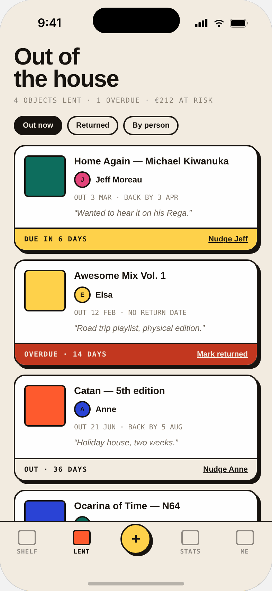 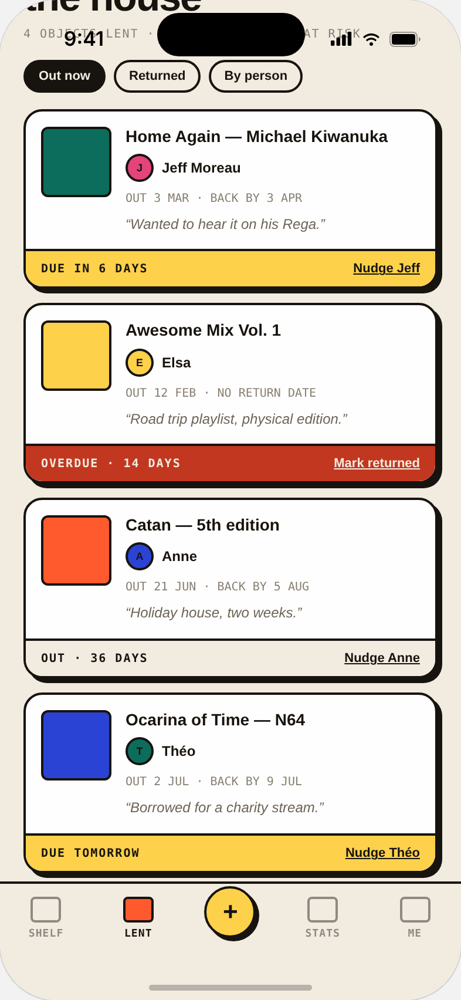

- **Purpose.** The lent-objects tab root, overdue first.
- **Layout.** The display title "Out of the house" and the meta "4 OBJECTS LENT · 1 OVERDUE · €212 AT RISK".
  Pills "Out now" (active) / "Returned" / "By person". Loan cards: a 60px colour block, the title, a borrower row
  (28px avatar circle with an initial + name), mono "OUT 3 MAR · BACK BY 3 APR", and an italic quote ("Wanted to
  hear it on his Rega."). Each card has a coloured footer strip under a 2.5px rule with a mono status and an
  underlined action: yellow "DUE IN 6 DAYS / Nudge Jeff"; rust "OVERDUE · 14 DAYS / Mark returned" (paper text);
  white "OUT · 36 DAYS / Nudge Anne"; yellow "DUE TOMORROW / Nudge Théo". Items: Home Again — Michael Kiwanuka (Jeff
  Moreau), Awesome Mix Vol. 1 (Elsa, "NO RETURN DATE"), Catan — 5th edition (Anne), Ocarina of Time — N64 (Théo).
  Tab bar with LENT active.
- **Components.** ScreenHeader, FilterPills, LoanCard with Avatar and a StatusFooter strip (due / overdue / out),
  TabBar.
- **Interactions.** Tab bar navigation. The footer actions lead to the nudge and return flows.
- **Differs from the decision log.** There's no LENT tab: overdue loans show in **Activity** and Today (PD-117,
  PLAN F13). "€212 AT RISK" is hidden (PD-080). The quotes are the optional loan note (PD-123), so a card with no
  note shows no quote line.

## 18 · lendsheet: Lend Malibu (sheet)

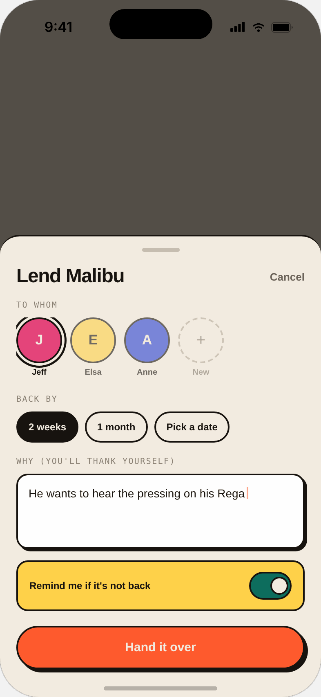

- **Purpose.** Lend an object in three taps.
- **Layout.** A sheet over an ink backdrop with a paper overlay at **.28** opacity. The sheet is paper, with a 2.5px
  top border, radius `24px 24px 0 0`, padding `14px 20px 34px`, and a **46×5 grabber** (`rule`, radius 99, 16px
  below). The header has "Lend Malibu" (Bricolage 800 24) and "Cancel". "TO WHOM" shows 52px avatars (2.5px ink,
  Archivo 700 17): Jeff is selected (pink, ring `0 0 0 3px paper, 0 0 0 5.5px ink`), Elsa (yellow) and Anne (cobalt)
  sit at .6 opacity, and a dashed "+ New". "BACK BY" pills: "2 weeks" (active) / "1 month" / "Pick a date". "WHY
  (YOU'LL THANK YOURSELF)" is a text area (white, `4px 4px 0 ink`) holding "He wants to hear the pressing on his
  Rega" with an orange caret (`pulseDot 1.1s`). A yellow row "Remind me if it's not back" has a toggle that's on. The
  CTA is **"Hand it over"** (orange).
- **Components.** BottomSheet, AvatarPicker, Pills, TextArea, ToggleRow, PrimaryButton.
- **Interactions.** Cancel goes to `item`. The CTA goes to `lending`.
- **Differs from the decision log.** PD-123 makes the note **optional**. Relabel "WHY (YOU'LL THANK YOURSELF)" as an
  optional note and don't require it. People are typed names, recent first (PLAN F13). There's one reminder on the
  due date.

## 19 · person: one borrower

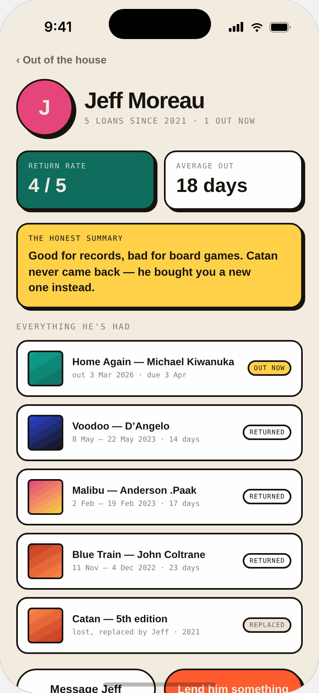 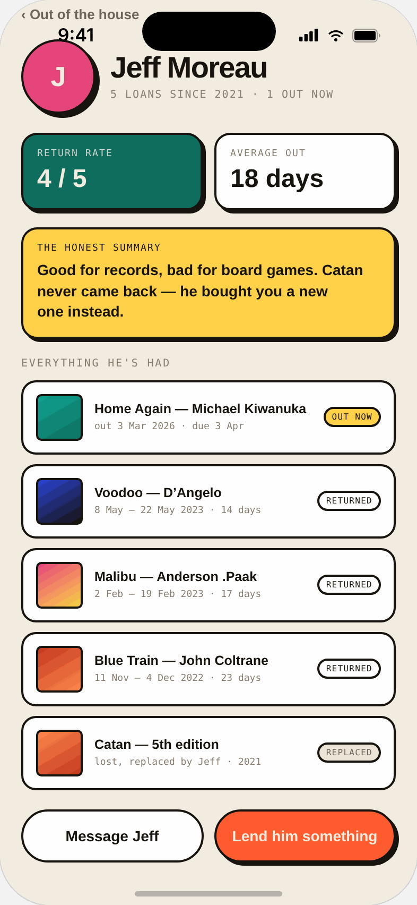

- **Purpose.** Everything one person has borrowed, and how it went.
- **Layout.** "‹ Out of the house". A 72px pink avatar "J" (`4px 4px 0 ink`) with the title "Jeff Moreau" and the meta
  "5 LOANS SINCE 2021 · 1 OUT NOW". Stat tiles "RETURN RATE 4 / 5" (green) and "AVERAGE OUT 18 days" (white). A yellow
  card with the eyebrow "THE HONEST SUMMARY": "Good for records, bad for board games. Catan never came back — he
  bought you a new one instead." Under "EVERYTHING HE'S HAD", rows with status chips: Home Again "out 3 Mar 2026 · due
  3 Apr" [OUT NOW, yellow]; Voodoo "8 May – 22 May 2023 · 14 days" [RETURNED]; Malibu [RETURNED]; Blue Train
  [RETURNED]; Catan "lost, replaced by Jeff · 2021" [REPLACED, sand/muted]. The buttons are "Message Jeff" and
  **"Lend him something"** (orange).
- **Components.** PersonHeader, StatTile, CalloutCard, HistoryRow + StatusChip, ButtonPair.
- **Interactions.** Back goes to `lending`. Lend goes to `lendsheet`.

## 20 · return: Back from Elsa (sheet)

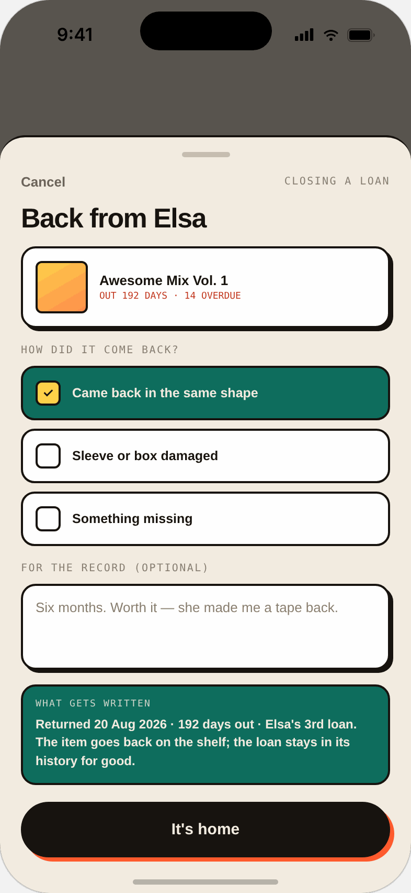

- **Purpose.** Close a loan and record how the object came back.
- **Layout.** A sheet: "Cancel" and the mono "CLOSING A LOAN", the title "Back from Elsa", and an object card
  "Awesome Mix Vol. 1" with the rust mono "OUT 192 DAYS · 14 OVERDUE". "HOW DID IT COME BACK?" lists check rows
  (radius 14). The selected one is a green row with a yellow 24px checkbox showing ✓: "Came back in the same shape".
  The others are white: "Sleeve or box damaged" and "Something missing". "FOR THE RECORD (OPTIONAL)" is a text area
  with the placeholder "Six months. Worth it — she made me a tape back." A green card with the eyebrow "WHAT GETS
  WRITTEN": "Returned 20 Aug 2026 · 192 days out · Elsa's 3rd loan. The item goes back on the shelf; the loan stays in
  its history for good." The CTA is **"It's home"** (ink with an orange shadow).
- **Components.** BottomSheet, ObjectSummaryCard, CheckRow, TextArea, CalloutCard, PrimaryButton.
- **Interactions.** Cancel and the CTA both go to `lending`.
- **Differs from the decision log.** The loan is closed by the collector only, and history records that it was
  one-sided (PD-160, PLAN F13). That's consistent with this board.

## 21 · nudge: notifications and rules

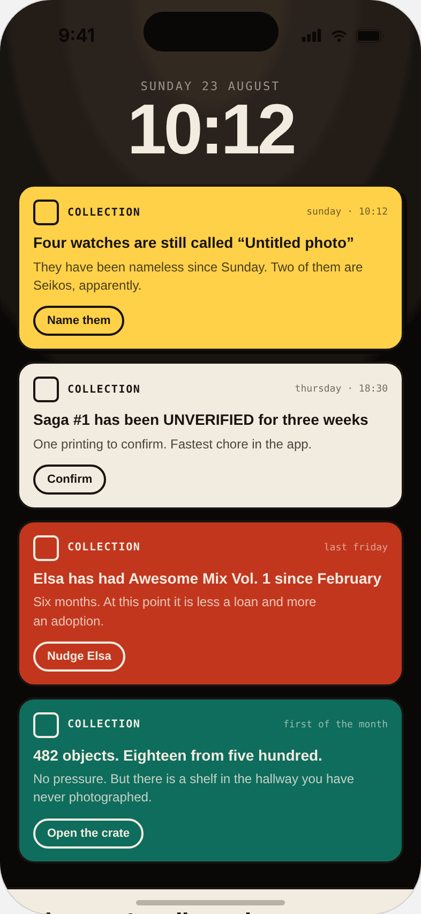 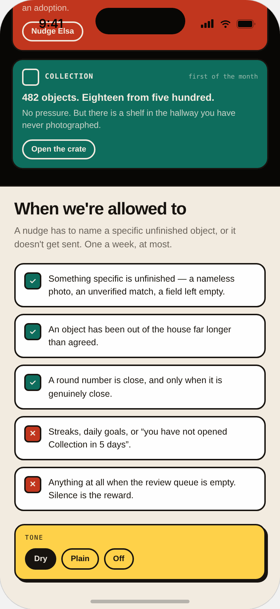

- **Purpose.** What a nudge looks like on the lock screen, and the rules for when one is allowed.
- **Layout.** The lock screen is a dark gradient with "SUNDAY 23 AUGUST" and "10:12" (Bricolage 800, ~66px). Four
  notification cards (radius ~18 *(seen)*, 2.5px), each with an app square, the mono "COLLECTION", a mono time, a
  bold title, body text and an outline action pill:
  - yellow: "Four watches are still called "Untitled photo"" / "They have been nameless since Sunday. Two of them are
    Seikos, apparently." / [Name them]
  - paper: "Saga #1 has been UNVERIFIED for three weeks" / "One printing to confirm. Fastest chore in the app." /
    [Confirm]
  - rust: "Elsa has had Awesome Mix Vol. 1 since February" / "Six months. At this point it is less a loan and more an
    adoption." / [Nudge Elsa]
  - green: "482 objects. Eighteen from five hundred." / "No pressure. But there is a shelf in the hallway you have
    never photographed." / [Open the crate]

  Then a paper section with the title "When we're allowed to" and the body "A nudge has to name a specific unfinished
  object, or it doesn't get sent. One a week, at most." Rule rows use a green ✓ box or a rust ✕ box (24px, 2.5px
  ink): ✓ "Something specific is unfinished — a nameless photo, an unverified match, a field left empty."; ✓ "An
  object has been out of the house far longer than agreed."; ✓ "A round number is close, and only when it is
  genuinely close."; ✕ "Streaks, daily goals, or "you have not opened Collection in 5 days"."; ✕ "Anything at all
  when the review queue is empty. Silence is the reward." A yellow card "TONE" with pills **Dry** (ink) / Plain / Off.
- **Components.** NotificationCard (four tone colours), RuleRow (✓/✕), Pills.
- **Interactions.** "Name them" goes to `review`.
- **Differs from the decision log.** In v1, **Nudge** opens the share sheet with a friendly line and the object card.
  There's no link to re-send (PLAN F13, PD-160).

## 22 · borrowed: In the house, not yours

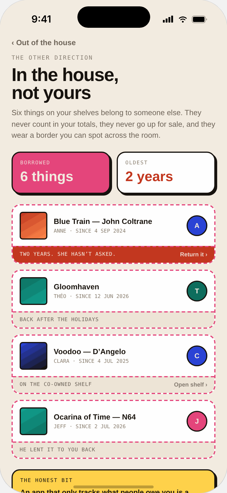 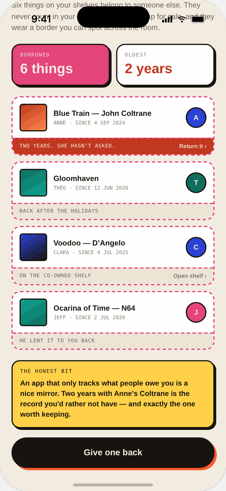

- **Purpose.** Objects you hold that belong to someone else.
- **Layout.** "‹ Out of the house", the eyebrow "THE OTHER DIRECTION", the title "In the house, not yours", and the
  body "Six things on your shelves belong to someone else. They never count in your totals, they never go up for
  sale, and they wear a border you can spot across the room." Stat tiles "BORROWED 6 things" (pink) and "OLDEST
  2 years" (rust text). Cards with a **2.5px dashed pink (#E5457B)** border and no shadow, each with a thumb, title,
  mono "ANNE · SINCE 4 SEP 2024", and an owner avatar on the right. Footer strips: rust "TWO YEARS. SHE HASN'T ASKED. /
  Return it ›"; sand "BACK AFTER THE HOLIDAYS"; "ON THE CO-OWNED SHELF / Open shelf ›"; "HE LENT IT TO YOU BACK".
  Items: Blue Train (Anne), Gloomhaven (Théo), Voodoo (Clara), Ocarina of Time (Jeff). A yellow card with the eyebrow
  "THE HONEST BIT": "An app that only tracks what people owe you is a nice mirror. Two years with Anne's Coltrane is
  the record you'd rather not have — and exactly the one worth keeping." The CTA is **"Give one back"** (ink with an
  orange shadow).
- **Tokens.** This is the not-yours rule (D27): a dashed edge and no shadow. The edge colour here is **pink**, while
  the wishlist uses `ruleDark`.
- **Components.** StatTile, ObjectCard (not-yours variant), StatusFooter, CalloutCard, PrimaryButton.
- **Interactions.** Back goes to `lending`.

## 23 · wishlist: The hunt

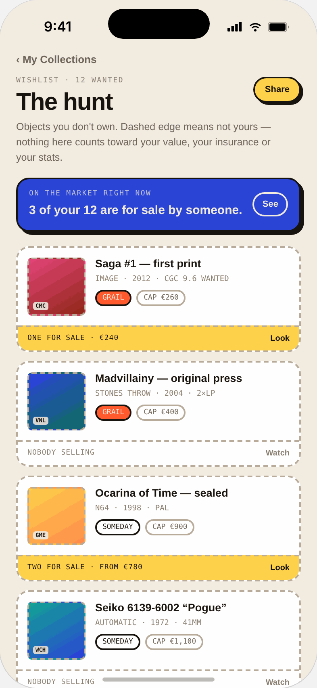 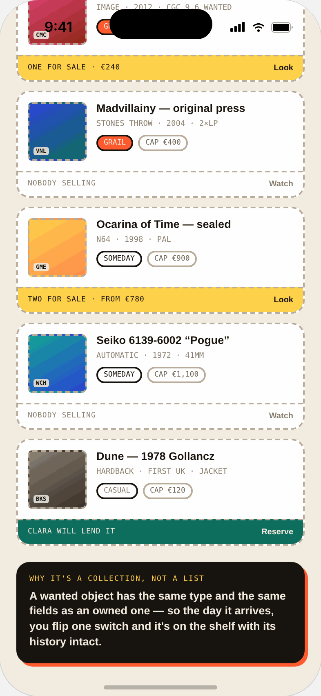

- **Purpose.** Wanted objects. They have the same type and fields as owned ones, with `owned: false`.
- **Layout.** "‹ My Collections", the eyebrow "WISHLIST · 12 WANTED", the title "The hunt", and a yellow "Share" pill
  (`4px 4px 0 ink`). The body: "Objects you don't own. Dashed edge means not yours — nothing here counts toward your
  value, your insurance or your stats." A cobalt banner with the eyebrow "ON THE MARKET RIGHT NOW": "3 of your 12 are
  for sale by someone." [See]. Cards with a **2.5px dashed `ruleDark`** edge, no shadow and a transparent/white
  fill. Each has a 72px tint thumb with a dashed edge and a mono mark badge (CMC, VNL, GME, WCH, BKS), the title, a
  mono spine, a priority chip (GRAIL in orange; SOMEDAY and CASUAL in outline) and a dashed "CAP €260" chip. Footer
  strips: yellow "ONE FOR SALE · €240 / Look"; white "NOBODY SELLING / Watch"; green "CLARA WILL LEND IT / Reserve".
  Items: Saga #1 — first print; Madvillainy — original press; Ocarina of Time — sealed; Seiko 6139-6002 "Pogue";
  Dune — 1978 Gollancz. An ink card (`4px 4px 0 orange`) with the eyebrow "WHY IT'S A COLLECTION, NOT A LIST": "A
  wanted object has the same type and the same fields as an owned one — so the day it arrives, you flip one switch
  and it's on the shelf with its history intact."
- **Components.** ObjectCard (not-yours / wanted), PriorityChip, CapChip (dashed), StatusFooter, Banner (cobalt),
  CalloutCard (dark).
- **Interactions.** Share goes to `wishshare`. Look goes to `hit`. With money off the caps become "ANY PRINT",
  "ORIGINAL ONLY" and so on, and the footers become "ADDED 12 AUG".
- **Differs from the decision log.** The market banner, "Look"/"Watch" and the € caps are out: no marketplace
  (PD-122), money off (PD-080). Use the `noMoney` copy from the source. "Reserve" is sketched only (D31). PLAN F3
  shows the wishlist as a dashed collection on the Shelf.

## 24 · stats: The numbers (Collection)

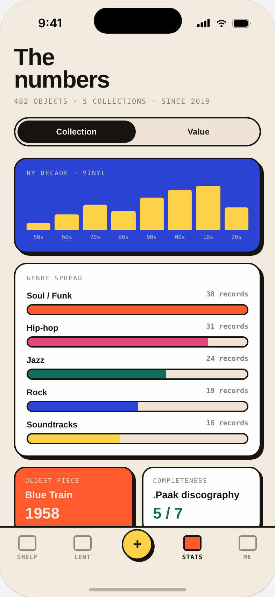 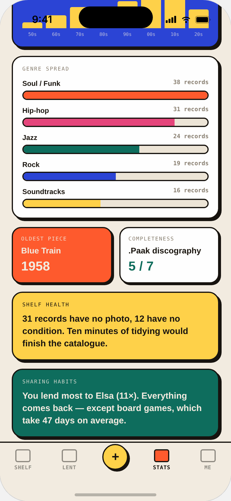
Value tab: 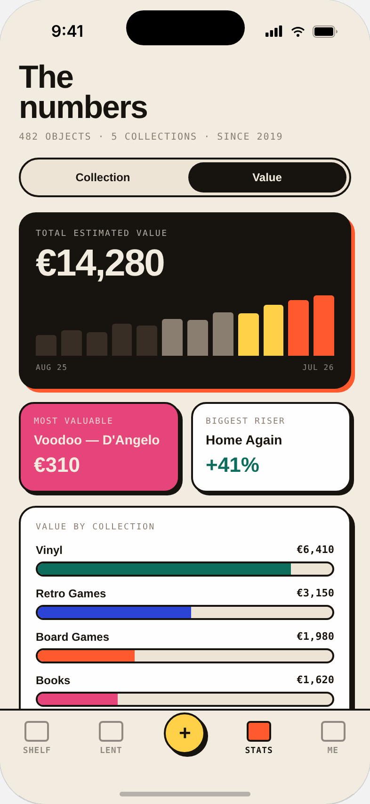 

- **Purpose.** The stats tab root.
- **Layout.** The display title "The numbers" and the meta "482 OBJECTS · 5 COLLECTIONS · SINCE 2019". A two-way
  segmented control "Collection | Value". A cobalt card "BY DECADE · VINYL" with yellow bars (50s…20s, mono labels in
  paper .6). A white card "GENRE SPREAD" with labelled bars: a 2.5px ink track, a sand background, a fill colour, and
  a mono count ("38 records"). Soul / Funk is orange, Hip-hop pink, Jazz green, Rock cobalt, Soundtracks yellow. Tiles
  "OLDEST PIECE Blue Train 1958" (orange) and "COMPLETENESS .Paak discography 5 / 7" (white, green number). A yellow
  card with the eyebrow "SHELF HEALTH": "31 records have no photo, 12 have no condition. Ten minutes of tidying would
  finish the catalogue." A green card with the eyebrow "SHARING HABITS": "You lend most to Elsa (11×). Everything
  comes back — except board games, which take 47 days on average." Tab bar with STATS active.
  - *Value* (board 38): an ink card (`4px 4px 0 orange`) "TOTAL ESTIMATED VALUE €14,280" with 12 monthly bars from
    "AUG 25" to "JUL 26", ramping from ink-brown through `meta`, yellow and orange. Tiles "MOST VALUABLE Voodoo —
    D'Angelo €310" (pink) and "BIGGEST RISER Home Again +41%". "VALUE BY COLLECTION" bars: Vinyl €6,410, Retro Games
    €3,150, Board Games €1,980, Books €1,620, Sneakers €1,120. Then the Sharing habits card.
- **Components.** SegmentedControl (2-up), BarChart card, HBar (labelled progress), StatTile, CalloutCard, TabBar.
- **Interactions.** `setStatsColl` and `setStatsValue` swap instantly.
- **Differs from the decision log.** The Value tab is out in v1 (PD-138), and there's no STATS tab in the bar
  (PD-117). Stats are reached elsewhere, likely under You or Shelf; check PLAN F12. Stats group by type and never
  average across types (PLAN F12).

## 25 · insure: valuation export

 

- **Purpose.** An insurer-ready PDF of the collection.
- **Layout.** "‹ Stats", the eyebrow "FOR SOMEONE ELSE TO READ", the title "A document your insurer accepts", and
  the body "One PDF: every object, what it's worth, and the evidence behind the number. The app is for you — this is
  for the claim." An ink card (`4px 4px 0 orange`) "DECLARED TOTAL €14,280 / 482 OBJECTS" with a yellow chip "31
  over €100". "WHICH NUMBER COUNTS AS VALUE" is a set of radio cards: "What you paid / Receipts back it up. Insurers
  argue least with this one." €11,940; the selected card is green with a yellow dot: "Market median today / Discogs,
  eBay sold, shop quotes — dated the day you export." €14,280; "Your own figure / Used for the 31 objects where you
  overrode the market." €15,610. "WHAT TRAVELS WITH EACH LINE" is a 2-up grid: Photos 482 / 482; 3D scans 61
  SPINNABLE; Receipts 203 ATTACHED (yellow); Condition YOUR GRADE + DATE; Serials & pressings WHERE KNOWN; Where it
  lives ROOM · CRATE · SLOT (sand, muted). A document preview card (sand header "PAGE 3 OF 41 · PREVIEW A4", then
  "SCHEDULE OF ITEMS — VINYL" rows with thumbs and a value + mono source: MEDIAN / YOURS / PAID). A yellow card with
  the eyebrow "SAID PLAINLY, ON PAGE ONE": "This is an owner's inventory, not a professional appraisal. Every figure
  names its source and its date, so an assessor can check the ones that matter." The buttons are "CSV too" and
  **"Build the PDF"** (green).
- **Components.** TotalCard (dark), RadioCard, InfoTile grid, DocumentPreview, CalloutCard, ButtonPair.
- **Interactions.** Back goes to `stats`.
- **Differs from the decision log.** With money off and no values in v1 (PD-138), this becomes the inventory without
  market figures (PLAN F17: "it isn't an appraisal"). There's no "3D scans" tile (PD-145).

## 26 · sold: Gone, but not forgotten

- **Purpose.** The archive of sold objects.
- **Layout.** "‹ My Collections", the title "Gone, but not forgotten", and the body "Sold items leave the shelf and
  stay in the archive. You'll want to know what you let go, and for how much." Tiles "SOLD IN 2026 €1,325" (green) and
  "VS WHAT YOU PAID +€331". Cards with a thumb, title, mono "TO vinylhound · 4 Aug 2026", and a sand footer with
  "€55 · paid €24" and a delta (green +€31, rust −€20). Items: In Rainbows — Radiohead; Lot 001 · Soul & Funk (18);
  Nintendo 64 · boxed. A yellow card with the eyebrow "STILL SEARCHABLE": "Archived items still answer "did I ever
  own this?" when you scan something in a shop — which is the whole point of keeping them."
- **Components.** StatTile, ArchiveCard with DeltaFooter, CalloutCard.
- **Interactions.** Back goes to `home`.
- **Differs from the decision log.** Selling is out (PD-135). In v1 the archive holds objects that were **let go**
  (the "Let go" action, PLAN F4), without prices.

## 27 · newtype: New collection · step 1

- **Purpose.** Pick a type for a new collection.
- **Layout.** "Cancel" and the mono "STEP 1 OF 2". The title "New collection", the body "A type decides which fields
  each object gets." "NAME" is an input (white, `4px 4px 0 ink`) holding "My Vinyls" with an orange caret
  (`pulseDot`). "TYPE" is a 2-up grid of type cards (radius 14, `4px 4px 0 ink`): a mark (Bricolage 800 ~26), the
  name (Archivo 700), and mono fields. The selected one is green: 33⅓ Vinyl "artist · album · year · barcode". Then
  D20 Board game "publisher · players · time", PVC Figurine "line · scale · edition", 16B Retro game "console · region
  · boxed", ISBN Book "author · publisher · edition", and a yellow "+ Custom… / define your own fields". "SHELF
  COLOUR" offers five 44px swatches (green, orange, yellow, pink, cobalt); the selected one has a paper + ink double
  ring. The CTA is **"Next — its fields"** (ink with an orange shadow).
- **Components.** ModalNavBar, TextField, TypeCard, SwatchPicker, PrimaryButton.
- **Interactions.** Cancel goes to `home`. Next goes to `newfields`.
- **Differs from the decision log.** v1 enables five types (PD-164, PLAN F1). The first object of a type creates its
  collection automatically (PLAN F6), so this picker isn't the first-run path (PD-166).

## 28 · notype: none of the fourteen fit

 

- **Purpose.** The way out when no built-in type fits.
- **Layout.** "‹ Pick a type", the rust eyebrow "NONE OF THE FOURTEEN FIT", the title ""I collect vintage 
  synthesisers"", and the body "The wrong answer is a list of fourteen tiles and a shrug. Three ways out, in the order
  we'd offer them." Three route cards, each with a numbered square badge (yellow, or `rule` for #3), a title, body,
  and a mono cost line under a rule:
  1. "Borrow the nearest type" (white): CHEAPEST · YOU KEEP LOOKUP AND GRADING · WRONG WORDS IN PLACES.
  2. "Build the type as you go" (green, `4px 4px 0`): BEST FIT · NO AUTO-FILL · TEN MINUTES OF WORK SPREAD OVER A
     WEEK.
  3. "Own it as a Thing" (no shadow): ZERO EFFORT · NOTHING TO FILTER ON LATER.

  A green card "SIX MONTHS LATER" with a "NEW" pill: "Synthesisers is an official type now — partly because you built
  one." / "Your 47 objects can move onto it, or stay exactly where they are. Nothing expires." / "See what would
  change ›" (yellow). "ROUTE 2, IN PROGRESS" is a type builder card: a sand header with a "SYNTH" thumb, "Synthesisers
  / YOUR TYPE · 3 FIELDS SO FAR" and a yellow "Rename" pill. Field rows carry kind badges: Manufacturer TEXT; Voices
  NUMBER; Synthesis CHOICE (yellow); Last serviced EVENT (green, with a green-bordered row). Then a dashed "+ Add a
  field — it becomes part of your type". A green card with the eyebrow "WHERE YOUR TYPE GOES NEXT". The buttons are
  "Start from Watches" and **"Build my own"** (orange).
- **Components.** RouteCard + NumberBadge, CalloutCard, TypeBuilder, FieldRow + KindBadge, DashedButton, ButtonPair.
- **Interactions.** "Build my own" goes to `addform`, "See what would change" to `migrate`, back to `newtype`.
- **Differs from the decision log.** A type that isn't enabled lands as a **Thing**, and the app says so (PLAN F2).
  v1 has 17 manifests with 5 enabled, not "fourteen".

## 29 · chrome: B1 · chrome spec

 

- **Purpose.** The spec for the nav and tab bars: "the bar is a sticker sitting on the page, never a translucent slab
  over it."
- **Layout.** The eyebrow "B1 · CHROME", the title "Our bars, not the system's", and the body "Five states, one
  rule: …". Five numbered specimens, each a card with a mono caption:
  1. **TOP OF A LIGHT SCREEN**: a yellow dot-grid header with "TUESDAY · 482 OBJECTS / My Collections". "Big title, dot
     grid, no chevron — nothing is behind it."
  2. **ONCE YOU SCROLL**: a compact bar with a round 44px back sticker "‹", the title "Malibu — Anderson .Paak" and a
     yellow avatar. "The title shrinks into the bar, back becomes a round sticker, and the bar keeps its 2.5px rule
     instead of blurring."
  3. **OVER THE DARK STAGE**: an ink bar, a paper-ringed back sticker, the yellow mono "ON THE STAGE" and a "Share"
     pill. "Same geometry, inverted ink. Item detail and capture use this one; the tab bar hides itself here."
  4. **INSIDE A MODAL**: a sand bar with "Close" (rust), the mono "LEND SHEET" and "Save" (green). "Close, not Back —
     a modal is its own world, so leaving it takes the whole world with it. Step two of the same flow shows ‹ Back on
     the left and keeps Close nowhere."
  5. **THE BOTTOM BAR IS A LAYOUT**: square 44px tab glyphs (radius ~12, 2.5px; active is ink-filled) labelled SHELF ▣,
     LENDING ↔, a raised 56px orange **SCAN** ◉ circle, STATS ▤ and SEARCH ⌕, with mono labels.

  A yellow card with the eyebrow "WHY THE MIDDLE ONE IS ROUND": "Four tabs take you somewhere; the shutter opens over
  wherever you already are. Different shape because it does a different thing."
- **Components.** LargeTitleHeader, CompactNavBar, DarkNavBar, ModalNavBar, TabBar (spec variant), BackSticker.
- **Differs from the decision log.** The tab labels follow PD-117: Shelf · Find · Scan · Activity · You. Keep the
  spec geometry: a round middle slot that presents, square glyphs, a 2.5px top rule and no blur.

## 30 · types: all fourteen types

  

- **Purpose.** Proves one row shape works for every type.
- **Layout.** The eyebrow "FOURTEEN TYPES · ONE ROW EACH", the title "The same row, fourteen vocabularies", and
  the body "Every type maps its own words onto three slots — title, subtitle, year — then adds a grade and the two
  fields its collectors actually quote. The row never changes shape." Legend chips: "EVERY COPY ITS OWN ROW" (ink)
  and "×N COUNTED IN BULK" (yellow). Full-bleed rows, zebra-striped (`rgba(255,255,255,.5)` on odd rows), separated by
  2.5px rules. Each row has a 56px tinted thumb (2.5px ink, `3px 3px 0 ink`, radius ~10) with the mark in a
  `rgba(243,236,224,.92)` mono badge, the title (Archivo 700 15), subtitle · year (`muted` 700), mono facts with an
  ellipsis, and on the right a grade chip (outline; yellow for bulk) over the value (Archivo 700). Bulk rows add a
  yellow "×3 / ×12 / ×4" chip after the title. Rows: Malibu 33⅓ VG+ €52; Uncanny X-Men #129 CGC VF €340; The Employees
  ISBN Fine €28; Agricola D20 Played €45; Secret of Mana 16BIT NM €180; Boba Fett 1/12 MIB €95; Galaxy Explorer BRICK
  Sealed €160; Air Jordan 1 Chicago US10 VNDS €420; Submariner 16610 AUTO Excellent €9,400; 993 Carrera VIN Driver
  €78,000; MT-09 CC Rider €5,900; Charizard TCG ×3 NM €260; 1 Dollar NUM ×12 XF-40 €38; 10 c PHIL ×4 MNH €6. The
  tints are `linear-gradient(150deg, a, b)` from {teal, cobalt, yellow, rust, orange #FF8A4C, pink}. An ink card
  (`4px 4px 0 orange`) with the eyebrow "WHAT THE ROW PROVES": "A stamp and a Porsche fit the same 70px because…".
- **Components.** ObjectRow (the canonical list row), TypeThumb + MarkBadge, GradeChip, QtyChip.
- **Differs from the decision log.** The values are hidden (PD-138). v1 enables 5 of 17 types (PD-164). One Roof
  rule 2 makes the row a **44px thumb** with two or three spine lines, **one status chip** and one trailing fact (see
  board 34). The type data comes from the manifests, not the UI layer.

## 31 · mixed: Mixed-type collection

 

- **Purpose.** A collection that holds several types.
- **Layout.** "‹ My Collections", the eyebrow "MIXED · 38 OBJECTS · 6 TYPES", the title "The dad's- garage shelf",
  and the body "Yes — a collection holds whatever you put in it. The collection has no type; every object carries
  its own. That's the whole rule, and everything below falls out of it." Type chips (pill, 2.5px, with a 22px tint
  square): Records · 14, Cartridges · 9, Figures · 6, Coins · 5, Watches · 3, Motorbike · 1. Object cards with a thumb
  + mark badge, title, mono facts and value: MT-09 · Yamaha €5,900; 1 Dollar · United States "×12 · … · COUNTED, NOT
  LISTED" €456; Blue Train · Coltrane "… · LENT TO ANNE" €420; Secret of Mana · SNES €180; Speedmaster · Omega €4,100.
  Under "WHAT CHANGES WHEN THE TYPES DON'T MATCH", rule cards: THE SPINE (white, shadow); SORTING AND FILTERS (no
  shadow); THE STATS (sand); ADDING (white); LENDING AND SELLING (green). The CTA is "Split it into six collections"
  (outline).
- **Components.** TypeChip (with a tint swatch), ObjectCard, RuleCard (tone variants), SecondaryButton.
- **Interactions.** Back goes to `home`. Stats goes to `stats`.
- **Differs from the decision log.** Values are hidden (PD-138). "Selling" in the last rule is out (PD-135). PLAN F4
  groups a mixed collection by type.

## 32 · tabpick: Which one sounds like you? (onboarding Q2)

 

- **Purpose.** The second onboarding question: picking a profile chooses the tab-bar arrangement.
- **Layout.** The eyebrow "SECOND QUESTION IN ONBOARDING", the title "Which one sounds like you?", and the body
  "One tap, and the bar arrives sensible. Nobody is asked to configure anything — this is a personality question with
  a layout as its answer." Three profile cards, each with a coloured dot, a title, body and a mini tab bar (square
  glyph buttons, raised orange SCAN, mono labels):
  - "I want to know what I have": SHELF · FIND · SCAN · INSIGHTS · YOU.
  - "I collect, and I lend" (green, selected): SHELF · FIND · SCAN · ACTIVITY · YOU.
  - "I hunt, trade and sell": SHELF · WANTS · SCAN · ACTIVITY · MARKET.

  A yellow card with the eyebrow "THE RULES THAT KEEP THIS SAFE" and four numbered rules (ink number squares). The
  buttons are "Arrange it myself" and **"Sounds right"** (orange).
- **Components.** ProfileCard, MiniTabBar, NumberedRule list, ButtonPair.
- **Interactions.** "Sounds right" goes to `home`. "Arrange it myself" goes to `tabedit`.
- **Differs from the decision log.** Profile and tab-bar screens are out (PD-144, PD-122). v1 has one fixed bar,
  Shelf · Find · Scan · Activity · You (PD-117). This matches the middle profile, so the card's mini-bar is a good
  visual reference for the v1 bar. This is **not** the onboarding first-piece screen (PD-166), which has no board in
  the archive.

## 33 · design-system: "Collector zine" reference sheet

- **Source.** `00_Design System.dc.html`, rendered full-page at 1216 px wide.
- **Content.**
  - 01 COLOUR: swatch cards (name, hex, use). Paper #F3ECE0 "Every light screen. Warm, never white."; Ink #17130F
    "Text, all borders, all hard shadows."; Sand #EDE4D6 "Tracks, tab wells, inactive fills."; Grey #8A7F70 "Mono
    labels and secondary text only."; Orange #FF5B2E "Primary action, board games."; Yellow #FFD24A "Attention,
    stickers, sneakers."; **Teal #0E6E5E** "Money in your favour, vinyl."; Pink #E5457B "Grails, books, delight.";
    Cobalt #2B44D6 "Data and stats, retro games."; Rust #C2371F "Overdue, loss, the only red."
  - "Rule of one": a screen carries paper + ink + *one* accent, and each collection owns an accent permanently.
  - "Pro mode = hue shift −52°" (out, PD-144).
  - 02 TYPE: Display / Bricolage 800 (22–62px, −3 to −5% tracking); Heading / Archivo 700 (13–15px); Body / Archivo
    400 (line-height 1.5, never below 12px); Meta / DM Mono 500 uppercase .12–.18em, 8–11px. "Three voices only".
  - 03 SURFACES & GEOMETRY: Card (2.5px ink, radius 14–18, shadow 4px 4px 0 ink); Inset row (no shadow, 1.5px
    hairline divider); Empty slot (dashed #B9AC99, "always an invitation, never an error"); Hero / dark (coloured
    shadow allowed). **Spacing scale 4 · 6 · 9 · 13 · 18 · 22 · 34**, screen gutter 20px, cards never nest more than
    two deep, halftone `radial-gradient` dots at 6–9px only on colour fields and cover art.
  - 04 COMPONENTS: Buttons (44px min): Primary ink with an orange shadow, Accent orange, Secondary outline,
    Quiet/cancel text. Stickers & chips: tilt ±2–6°, only on stickers that sit on an object, max two tilted per
    screen, chips in lists stay straight. A segmented Tab control. Fields & toggle: the field has a `3px 3px 0`
    shadow and the toggle row is yellow. "Field values are typed… The type badge is always mono."
  - 05 THE OBJECT: Object hero (3D, out by PD-145) and material swatches (Black, Coke-bottle, Splatter, Marbled,
    Picture disc).
  - 06 PRINCIPLES: The object outranks the app; Money is optional; An account is optional too; Every loan has a
    reason (superseded by PD-123); Fields are typed, not free; Nothing saves silently (auto-filled values are badged
    AUTO).
- **Naming conflict.** This page calls #0E6E5E **"Teal"**. The handoff README calls #0E6E5E **"Green"** and #12A594
  **"Teal"**. The token table below uses `green` = #0E6E5E and `teal` = #12A594, to match the README and the type
  gradients.

## 34 · one-roof: the type rules (seven slots, signatures, status swatches)

  
 

- **Source.** `42_One Roof.dc.html` with the default prop `type: Wine`, rendered full-page at 1200 px and split into
  five slices. The background is sand, and the content uses the same tokens.
- **Content, which sets v1 structure (PD-013).**
  - Thesis: "The app owns the verbs. The type owns the nouns." with "the app fixes the structure and the verbs; a type
    may only fill slots."
  - **01 Demonstration.** One item screen in a phone frame, where every slot is a dashed cobalt box with a mono
    label. The slots, in order:
    1. **HERO**: one 3D silhouette per type; in v1 a photo or flat hero.
    2. **SPINE**: 2–3 facts, which the type names. "Léoville-Barton / Saint-Julien · Bordeaux / 2015 · VINTAGE IS
       IDENTITY".
    3. **STATUS**: one chip from the same palette, e.g. "Drink it" (green) + "MATURITY · ESTIMATE".
    4. **SIGNATURE**: 0–2, bound from the kit. The maturity gauge (2015 … PEAK 2032–41 … 2050, with an orange "now"
       marker) and the case "4 OF 6 LEFT" drawn as bottles.
    5. **FIELDS**: the kind decides the control. Bottles left 4 of 6, Window 2025 – 2050, Fill Into neck, Rack
       Cellar · B3.
    6. **ACTIONS**: the app verbs plus at most one type verb. Lend (ink), Move, Edit, and the dashed cobalt type verb
       "Open a bottle".
    7. **HISTORY**: append-only, shared events plus type events. "SEP 2026 Opened · with Claire…", "JAN 2026 Moved ·
       Cellar B3", "MAR 2019 Acquired · 6 × €62".

    Type pills switch the demo between Vinyl / Wine / Retro computer / Retro game / Enamel pin (Thing). Notes cover
    what changed, what couldn't, the type verb, the signature, the status chip and the ESTIMATE label.
  - **Status swatches:** **FINE** (sand), **GOOD** (#B9F0C9 mint), **WATCH** (yellow), **ACT** (rust), **GONE**
    (ink). Every derived state maps to these five, and anything computed carries the mono word **ESTIMATE**.
  - **02 Contract:** "A type may declare" (spine labels, fields with a kind from the shared kit, one condition scale
    with up to two further axes, a bulk rule, type events, one derived status and one clock, one type verb, 0–2
    signatures, a lookup strategy, identity) versus "A type may never" (add a screen/tab/sheet/route, reorder or hide
    the seven slots, draw its own signature, rename an app verb, introduce a colour/font/icon style/status outside the
    shared five, invent a field kind, send more than one kind of notification, touch money/people/places/sharing,
    collect personal data).
  - **03 Signatures:** "A signature *renders*; it never *collects*." The launch types table (Wine maturity gauge and
    case, Vinyl grade ladder, Retro computer power-on panel and system map, Retro game CIB ladder, Thing none). Five
    rules, including at most two signatures, each ≤ **64pt** tall, sitting between status and fields; the type accent
    is allowed here; invisible everywhere except the item screen.
  - **04 Seven rules of coexistence:**
    1. Identity lives in the object, never in the chrome. The accent appears in exactly four places.
    2. One row shape from a stamp to a Porsche: **a 44px thumb, 2–3 spine lines, one status chip, one trailing fact**.
    3. Six fields every object has: title, acquired, paid, condition, location, notes.
    4. Stats group by type.
    5. The add flow is capture → propose → confirm → fill.
    6. Type vocabulary in the fields, app vocabulary everywhere else.
    7. One clock per type, and all clocks tell the same time.
  - **05 Shared kit:** eleven kinds (number · choice · text, scale, date · year, yearRange, log, quantity, composite,
    list) with the control each gets.
  - **06** The proposal checklist. **07** Pushback Q1–Q4 on dark cards with an orange shadow. **08** Slot order stays
    fixed and emphasis is type-owned (hero tall | short | none, spine 2 or 3 lines, signature compact | tall, history
    collapsed | open).
  - **09** Ladder generalised: `ladder(scale, axes, allowMissing)`; renderers ladder 14 types, set 11, gauge 7, panel
    3, map 1–2, case 1; triptych withdrawn.

## 35–40 · state variants

These are covered in the sections above: 35–37 are the item tabs (§04), 38 is the stats Value tab (§24), and 39–40
are the scan Photo and Look-it-up modes (§09).

---

## Component inventory

Every component below has the shared anatomy: ink edges at 2.5px (2px on small chips), hard offset shadows, Archivo for
UI, DM Mono for meta and Bricolage for display. "Boards" lists board numbers.

| Component | Boards | Variants | Key tokens |
|---|---|---|---|
| **TabBar** | 01, 03, 17, 24, 29, 32 | 5 slots; active (full opacity, orange-filled glyph) vs inactive (`opacity .45`); spec variant with 44px square glyphs and a 56px orange SCAN | height 88, `border-top 2.5px ink`, paper background, glyph 22×18 radius 4; middle 40×40 radius 999, yellow, `margin-top -9px`, `3px 3px 0 ink`; labels DM Mono 600 9px .06em |
| **NavBar** | all | LargeTitle (no chevron), BackLink "‹ X", Compact (round back sticker), Dark (stage), Modal (Cancel/Close · mono title · Save) | back Archivo 600 13 `muted`; modal Save orange/green; dark pills 2px `rgba(243,236,224,.35)` |
| **ScreenHeader** | 01, 03, 05, 17, 22–28, 30–32 | eyebrow + display title (+ mono meta + body) | eyebrow DM Mono 500 10 .14em `meta`; title Bricolage 800 30–36 / .95–.98 / −.03em with deliberate ` `; body Archivo 400 13/1.5 `muted` |
| **Card** | everywhere | white / sand / ink (dark) / green / yellow / cobalt / pink / rust; shadow 3, 4 or none; dark card shadow orange | 2.5px ink, radius 14–18, padding 13–16, `3px 3px 0 ink` or `4px 4px 0 ink` (`4px 4px 0 #FF5B2E` on ink) |
| **CalloutCard** | 05, 07, 15, 19, 22–28, 30, 31 | yellow / green / ink / sand; mono eyebrow + bold body | eyebrow DM Mono 500 9–10; body Archivo 700 13.5–15 /1.35–1.4 |
| **Button** | most | Primary ink + orange shadow; Accent orange + ink shadow; Green; Secondary outline; Quiet text; ButtonPair (flex 1:1, gap 10) | pill radius 999, 2.5px ink, padding 15, Archivo 700 14; min height 44 |
| **Pill / FilterPills / SortPills** | 01, 03, 17, 18, 21 | active ink with paper text; inactive outline | Archivo 600–700 12–13, padding 7/11–12, 2.5px ink, radius 999 |
| **SegmentedControl** | 04, 09, 13 (yes/no), 24 | light (sand track, ink active) / dark camera (yellow active, text `rgba(243,236,224,.7)`) | track 2.5px ink, radius 999, padding 3, gap 3–6; segment Archivo 600 11, padding 8/4; instant switch |
| **Chip / Sticker** | 04, 03, 10, 14, 23, 30 | flat chip; tilted sticker (±2–6°, max two per screen, only on objects); GRAIL pink; genre yellow | DM Mono 500 8–9 .08em, 2px ink, radius 999, padding 3–4 / 6–8 |
| **StatusChip** | 10, 15, 19, 34 | QUEUED yellow, SAVED green, RETURNED outline, REPLACED sand; v1 five swatches **fine / good / watch / act / gone** | DM Mono 500 9 .1em, 2px ink, pill |
| **KindBadge** | 13, 28, 35 | TEXT, NUMBER, CHOICE, DATE, MONEY, YES / NO, LIST, EVENT | sand pill, 1.5px `rule` border, DM Mono 9, `muted` |
| **AutoBadge** | 12 | AUTO (yellow), SUGGESTED (yellow), YOURS (mono text) | DM Mono 9, yellow fill, 2px ink |
| **CollectionTile** | 01 | type tile; dashed "New collection type" | tint block + dots, count badge (ink, radius 6), mark Bricolage 800 34/.85 −.04em, foot under a 2.5px rule; radius 18 |
| **ObjectTile / SleeveTile** | 03 | grail / lent sticker | aspect 1, radius 6, `4px 4px 0 ink`, dots `rgba(23,19,15,.22)` 1px @ 7px, title Bricolage 800 17 |
| **ObjectRow** | 07, 10, 14, 15, 19, 26, 30, 31 | with match line, status chip, value, ×N qty chip, footer strip; zebra full-bleed (types) | thumb 44–56 2.5px ink + mark badge `rgba(243,236,224,.92)`; title Archivo 700 13–15; meta DM Mono 9–10 |
| **ObjectCard (not-yours)** | 22, 23 | wanted (`ruleDark` dashed) / borrowed (pink dashed); footer strips | 2.5px dashed, **no shadow** (D27) |
| **StatusFooter** | 17, 22, 23, 26 | due (yellow), overdue (rust + paper text), out (white), lend (green), sand | under a 2.5px rule; DM Mono status left + underlined Archivo 700 action right |
| **LoanCard** | 17 | due / overdue / out | 60px colour block, Avatar 28, quote in italic `muted` |
| **Avatar / AvatarPicker** | 01, 17, 18, 19, 22 | 28 / 44 / 52 / 72px; selected ring; dashed "+ New" | circle 2.5px ink, Archivo 700; selected `0 0 0 3px paper, 0 0 0 5.5px ink`; unselected opacity .6 |
| **BottomSheet** | 06, 11, 18, 20 | with header (Cancel · mono title) | backdrop ink + paper overlay at .28 (spec .28–.32); sheet paper, 2.5px top, radius `24px 24px 0 0`, padding `14px 20px 34px`; grabber 46×5 `rule` radius 99 |
| **Form fields** | 12, 13, 27 | Text, Stepper, ChoiceChips (+ dashed "+ option"), DateField (Today + calendar glyph), MoneyField (€ prefix cell), YesNoSegment, ListField, EventField (yellow), TextArea | 2.5px ink, radius 11, white, padding 10/12, Archivo 600 13; numbers DM Mono 600 15; stepper buttons 26×26 radius 7 |
| **FieldLabel** | 12, 13 | mono label + kind / AUTO badge | DM Mono 500 10 .12em `meta` |
| **Toggle / ToggleRow** | 08, 18 | on (green track, knob right) / off (sand, knob left); yellow row | 46×27 radius 999 2.5px; knob 19×19 paper 2px ink |
| **SettingsRow** | 08 | disclosure with a mono value + › | card radius 14, padding 13/14 |
| **CheckRow / RuleRow / RadioCard** | 20, 21, 25 | checked = green row + yellow check box; ✓ green / ✕ rust boxes; radio selected = green card + yellow dot | 24px boxes 2.5px ink radius ~6 |
| **NumberedStep / NumberBadge** | 06, 28, 32 | yellow circle / yellow or `rule` square / ink square | 24–28px, 2.5px ink, Archivo 700 |
| **StatTile** | 19, 22, 24, 26, 38 | green / white / pink / orange / ink | eyebrow + Bricolage 800 24–36 number |
| **BarChart / HBar** | 24, 38 | vertical decade bars (yellow on cobalt), monthly value bars, labelled horizontal bars | HBar track 2.5px ink, sand background, fill per type colour |
| **Timeline** | 36, 34 | history entries | 2px `rule` spine, 2.5px-ringed dots, DM Mono date, Archivo 700 text |
| **SearchField / TokenChip** | 07 | tokens in cobalt / green; caret | card field `4px 4px 0`; token mono key + Archivo 700 value + × |
| **Banner / InfoBanner / NotificationBanner** | 08, 11, 12, 13, 23 | green (pre-filled), cobalt (edit warning, market), paper notification | 2.5px ink, radius 14, Archivo 700 13 |
| **Camera: Viewfinder / ScanLine / DestinationPill / MatchCard** | 09, 39, 40 | barcode / look / photo | camera #0C0A08, gradient `#2A231C→#0C0A08`; yellow 4px corners 34×34; orange scan line + glow, `camScan 1.8s` |
| **EmptyState** | 02 | illustration + heading + body + CTA | dashed `ruleDark` frame radius 22; shapes rotated −9° / 7° |
| **DashedNote / DashedButton / MediaSlot** | 05, 12, 13, 15, 16, 28 | note text; "+ Custom field"; "+ Photo" | 2.5px dashed `ruleDark`, `meta` text, radius 12–18 |
| **SwatchPicker** | 13, 27 | shelf colour / disc colour | 44px circles 2.5px ink; selected double ring |
| **ProgressBar / ProgressCard** | 16 | import progress | track paper-bordered, fill yellow; ink card with orange shadow |
| **Slot frame (seven slots)** | 34 | hero, spine, status, signature, fields, actions, history | v1 object screen order (PD-013); signature ≤ 64pt |
| **Signature renderers** | 34 | ladder, set, gauge, panel, map, case | type accent allowed; ESTIMATE label on derived values |

## Token table

Values come from the prototype's inline CSS (`35_Collections App.dc.html`). Counts are occurrences in the template, as
a guide to what's canonical.

### Colour

| Token | Hex | Count | Use |
|---|---|---|---|
| `ink` | #17130F | 880 | every border, every hard shadow, primary text, dark surfaces |
| `inkSoft` | #241F19 | 4 | inner rings on dark (disc edge, sleeve back) |
| `paper` | #F3ECE0 | 254 | screen background, text on dark |
| `sand` (paper warm) | #EDE4D6 | 32 | tracks, inactive fills, footers, segmented track |
| `paperDeep` | #DDD2C0 | 2 | sticky headers on warm screens |
| `card` | #FFFFFF | n/a | raised cards |
| `muted` | #6E6458 | 130 | secondary body |
| `meta` (grey) | #8A7F70 | 220 | mono eyebrows, tertiary |
| `rule` | #C9BFB0 | 14 | grabber, timeline, inert tracks |
| `ruleDark` | #B9AC99 | 37 | dashed not-yours / add-new edges |
| `yellow` | #FFD24A | 145 | accent, stickers, active camera segment, scan button |
| `orange` | #FF5B2E | 69 | primary CTA, dark-card shadow, scan line |
| `pink` | #E5457B | 28 | grail, borrowed edge, accent |
| `green` | #0E6E5E | 60 | money in your favour, ON toggle, confirm, "Teal" on the DS page |
| `teal` | #12A594 | 4 | type tint |
| `cobalt` | #2B44D6 | 21 | data, info banners, type tint |
| `rust` | #C2371F | 16 | overdue, loss, negative delta, the only red |
| `orangeSoft` | #FF8A4C | 1 | type-tint stop, sparkle |
| `mint` | #B9F0C9 | 1 (+ One Roof) | status swatch GOOD |
| `camera` | #0C0A08 | 16 | camera background; gradient `linear-gradient(180deg,#2A231C,#0C0A08)` |
| on-dark alphas | `rgba(243,236,224,.18–.7)` | n/a | dark-surface text and rules (.7 inactive segment, .35 outline pill, .25 unselected disc ring) |
| backdrop | ink + paper overlay at `.28` | n/a | sheet dim |
| status swatches | fine sand · good #B9F0C9 · watch #FFD24A · act #C2371F · gone #17130F | n/a | One Roof |

### Typography

| Role | Spec | Notes |
|---|---|---|
| Display title | Bricolage Grotesque 800, 30–36px, lh .95–.98, −.03em | keep the ` ` breaks |
| Display small / sheet title | Bricolage 800, 22–28px, lh 1, −.03em (−.02em at 22) | |
| Big number | Bricolage 800, 24–28px (lh 1.1, −.02em); lock screen 66px −.04em | |
| Type mark | Bricolage 800, 17–34px, lh .85, −.04em | |
| Heading / button | Archivo 700, 13–15px | 14px on CTAs |
| Label / nav | Archivo 600, 11–13px | back link 600 13 |
| Body | Archivo 400, 13/1.5 (also 12–12.5/1.45–1.5, 11/1.4 secondary) | never below 11 |
| Meta / eyebrow | DM Mono 500, 9–10px, letter-spacing .12–.14em, uppercase | most common: 9px (180×), 10px (104×) |
| Meta small | DM Mono 500, 8–8.5px | stickers, badges |
| Numeric value | DM Mono 600, 15px | steppers, money |

### Spacing

| Token | Value |
|---|---|
| Scale (DS page) | 4 · 6 · 9 · 13 · 18 · 22 · 34 |
| Screen gutter | 20px (18 dense, 24 empty state) |
| Top inset | 58–74px (66 typical) |
| Bottom inset | 108px with tab bar; 36–40px without |
| Screen padding (most common) | `66px 20px 40px` |
| Card padding | 13–16px (11–13 compact rows) |
| Gaps | 5–14px (most used: 10, 8, 11, 9) |
| Sheet padding | `14px 20px 34px` |

### Radius

| Use | Value |
|---|---|
| Pills, buttons, avatars, toggles | 999px (276×) |
| Cards, fields | 14px (81×), 16px (66×), 11px for inputs, 18px for large cards |
| Chips, counters, glyphs | 4–8px (tab glyph 4, count badge 6, stepper 7) |
| Sleeve tile | 6px |
| Bottom sheet | `24px 24px 0 0`; item panel `22px 22px 0 0` |

### Border

| Use | Value |
|---|---|
| Default | `2.5px solid #17130F` (388×) |
| Small chips, segmented buttons | `2px solid #17130F` (134×) |
| Hairline inside cards | `1.5px solid rgba(23,19,15,.12)` or `1.5px solid #C9BFB0` |
| Not yours / add new | `2.5px dashed #B9AC99` (borrowed: `2.5px dashed #E5457B`) |
| On dark | `2px solid rgba(243,236,224,.35)`; selected `2px solid #FFD24A` |
| Camera corners | `4px solid #FFD24A` |

### Shadow (hard offset only, never blurred in chrome)

| Use | Value |
|---|---|
| Cards, chips, small | `3px 3px 0 #17130F` (101×) |
| Large cards, banners | `4px 4px 0 #17130F` (68×) |
| Dark cards, ink CTAs | `4px 4px 0 #FF5B2E` (22×); documents `5px 5px 0 #FF5B2E` |
| Selected avatar / swatch | `0 0 0 3px #F3ECE0, 0 0 0 5.5px #17130F` |
| Pressed | collapse: `transform: translate(1px,1px)` |
| Exceptions (object only) | disc `0 14px 32px rgba(0,0,0,.55)`, scan line glow `0 0 14px #FF5B2E`, sparkle glow |

### Texture and motion

| Token | Value |
|---|---|
| Halftone dots | `radial-gradient(#17130F 1.1px, transparent 1.2px)` at 7–9px tiles; on tiles `rgba(23,19,15,.22) 1px` @ 7px; on dark `#F3ECE0 1px` |
| Type tint | `linear-gradient(150deg, a, b)` per type (from the manifests) |
| `pulseDot` | opacity .35 → 1 → .35, 1.1s (carets) / 1.2s (offline dot), infinite |
| `camScan` | translateY 0 → 150px, 1.8s ease-in-out infinite alternate |
| `sparkPop` / `sparkGlow` | 900ms ease-out, cleared at 950ms (not built, PD-145) |
| Item idle rotation | ±34°, 0.18°/frame (not built, PD-145) |
| Segment / tab switch | instant, no animation |

## Theme adjustments for contrast

PLAN §10 answer 8: keep every fill colour and use text colours that pass WCAG AA (4.5:1). The Board theme
(`TegolaTheme.board`) differs from the boards in exactly these places, checked by `ContrastTests` unless the row says
otherwise. On dark surfaces, mono labels keep the archive's `#8A7F70` (`textMetaOnStage`: 4.71:1 on ink, 5.04:1 on
the camera), because the darker `metaText` would be 2.74:1 there:

| Boards draw | Ratio | Tegola draws | Ratio | Where |
|---|---|---|---|---|
| Meta grey `#8A7F70` text (mono eyebrows, counts, spine labels) | 3.34:1 on paper | `metaText` `#645A4E` | 5.74:1 on paper, 4.51:1 on paper deep | every board with a mono label |
| Paper text on orange (e.g. "Sell it", orange CTAs) | 2.63:1 | ink text | 5.97:1 | 04, 12, 18 and any orange button |
| Paper text on pink (the ★ GRAIL sticker) | 3.27:1 | ink text | 4.81:1 | 04, 23 |
| Paper text on teal `#12A594` | 2.62:1 | ink text | 6.01:1 | type tints carrying text: no role maps to teal yet, so this pair joins `ContrastTests` with the tile component in M3 |

Muted body text (`#6E6458`) keeps the archive's value. It passes on paper, sand and card. On paper deep (3.88:1) and
yellow (4.02:1), components use `metaText` instead.
